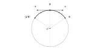
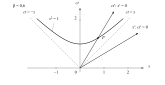
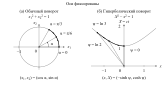
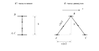
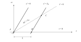
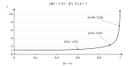
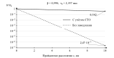

# Псевдоевклидово пространство и локальная симметрия сферы

Дифференциальная геометрия и основы тензорного исчисления. Вариант №9.

[Титульный лист, задание и календарный план](assets/front-matter.pdf)

## Введение

Геометрия позволяет описывать форму объектов, измерять расстояния и исследовать симметрию. При изучении поверхностей к этим вопросам добавляется вычисление кривизны.

В этой работе рассматриваются псевдоевклидово пространство и сфера. Обе темы связаны с изучением преобразований, сохраняющих геометрические свойства. Особый интерес представляет применение псевдоевклидовой геометрии в специальной теории относительности: вопросы об измерении времени и длины получают здесь математическое описание.

**Цель курсовой работы** — изучить основные свойства псевдоевклидова пространства, исследовать кривизну и локальную симметрию сферы, а также рассмотреть связь псевдоевклидовой геометрии со специальной теорией относительности.

## 1. Псевдоевклидово пространство и его изометрии

### 1.1. Билинейная форма и её матрица

Пусть $V$ — вещественное линейное пространство размерности $n$. **Билинейная форма** на $V$ — числовая функция двух векторов, линейная по каждому аргументу:
```math
\begin{aligned}
g&:V\times V\to\mathbb R,\\
g(\alpha\vec{u}+\beta\vec{v},\vec{w})
&=\alpha g(\vec{u},\vec{w})+\beta g(\vec{v},\vec{w}),\\
g(\vec{u},\alpha\vec{v}+\beta\vec{w})
&=\alpha g(\vec{u},\vec{v})+\beta g(\vec{u},\vec{w}),
\end{aligned}
```
где $\vec{u},\vec{v},\vec{w}\in V$, $\alpha,\beta\in\mathbb R$.

Форма называется **симметричной**, если
```math
g(\vec{u},\vec{v})=g(\vec{v},\vec{u}).
```
Форма **невырожденна**, если
```math
\bigl(\forall\vec{v}\in V\quad g(\vec{u},\vec{v})=0\bigr)
\quad\Longrightarrow\quad\vec{u}=\vec{0}.
```
*Далее рассматриваются симметричные невырожденные формы.* Векторы $\vec{u},\vec{v}$ ортогональны, если $g(\vec{u},\vec{v})=0$.

В базисе $\vec{e}_1,\ldots,\vec{e}_n$ разложим оба вектора и применим билинейность [1, с. 44–45]:
```math
\vec{u}=\sum_i x^i\vec{e}_i,\qquad \vec{v}=\sum_j y^j\vec{e}_j,
\qquad g(\vec{u},\vec{v})=\sum_i\sum_j x^iy^j g(\vec{e}_i,\vec{e}_j).
```
Обозначим $g_{ij}=g(\vec{e}_i,\vec{e}_j)$. Тогда
```math
\begin{gathered}
G=(g_{ij}),\qquad g_{ij}=g(\vec{e}_i,\vec{e}_j),\\
g(\vec{u},\vec{v})=\sum_{i,j=1}^{n}g_{ij}x^iy^j
=\vec{x}^{\mathsf T}G\vec{y},\\
G^{\mathsf T}=G,\qquad \det G\ne0.
\end{gathered}
```
Здесь $\vec{x}=(x^1,\ldots,x^n)^{\mathsf T}$ и $\vec{y}=(y^1,\ldots,y^n)^{\mathsf T}$ — столбцы координат векторов $\vec{u}$ и $\vec{v}$.

Столбцы матрицы перехода $C$ содержат координаты нового базиса в старом. Тогда
```math
\begin{aligned}
\vec{x}&=C\vec{x}',\qquad \vec{y}=C\vec{y}',\\
g(\vec{u},\vec{v})&=(C\vec{x}')^{\mathsf T}G(C\vec{y}')
=\vec{x}'^{\mathsf T}(C^{\mathsf T}GC)\vec{y}',\\
G'&=C^{\mathsf T}GC.
\end{aligned}
```

### 1.2. Сигнатура формы

Функция $\vec{u}\mapsto g(\vec{u},\vec{u})$ называется **квадратичной формой**, соответствующей $g$. По **закону инерции Сильвестра** [1, с. 148–150] можно выбрать базис, в котором она записывается как сумма квадратов с коэффициентами $1$ и $-1$:
```math
\begin{aligned}
G&=J_{p,q}=\operatorname{diag}(E_p,-E_q),\qquad p+q=n,\\
g(\vec{u},\vec{u})&=\sum_{i=1}^{p}(x^i)^2-\sum_{i=p+1}^{n}(x^i)^2.
\end{aligned}
```
Число положительных квадратов $p$ и число отрицательных квадратов $q$ не зависят от выбора базиса. Пара $(p,q)$ называется **сигнатурой формы**.

**Псевдоевклидово пространство** — пара $(V,g)$, где $g$ — симметричная невырожденная билинейная форма. При $q=0$ получаем евклидово пространство. При $p,q>0$ значение $g(\vec{u},\vec{u})$ может быть положительным, отрицательным или нулевым.

Далее рассмотрим плоскость с координатами $(X,x)$ и формой
```math
g\bigl((X,x),(Y,y)\bigr)=XY-xy.
```
Для ненулевого вектора $\vec{u}=(X,x)$ нулевое значение квадратичной формы задаёт две прямые:
```math
g(\vec{u},\vec{u})=0\quad\Longleftrightarrow\quad x=\pm X.
```
Эти прямые существуют и при невырожденной матрице $\operatorname{diag}(1,-1)$. Равенство $g(\vec{u},\vec{u})=0$ означает ортогональность вектора самому себе, а не всем векторам пространства.

### 1.3. Ортогональное дополнение и изометрии

При рассмотрении касательной плоскости сферы понадобится **ортогональное дополнение** подпространства $W$:
```math
W^\perp=\{\vec{u}\in V:\forall\vec{w}\in W\quad
g(\vec{u},\vec{w})=0\}.
```
**Линейная изометрия** сохраняет билинейную форму. Для её матрицы $L$:
```math
\begin{aligned}
g(L\vec{u},L\vec{v})&=\vec{x}^{\mathsf T}L^{\mathsf T}GL\vec{y},\\
g(L\vec{u},L\vec{v})=g(\vec{u},\vec{v})
&\Longrightarrow\vec{x}^{\mathsf T}(L^{\mathsf T}GL-G)\vec{y}=0.
\end{aligned}
```
Равенство выполняется для любых столбцов $\vec{x},\vec{y}$, значит каждый элемент матрицы в скобках нулевой. Поэтому
```math
g(L\vec{u},L\vec{v})=g(\vec{u},\vec{v})
\quad(\forall\vec{u},\vec{v}\in V)
\quad\Longleftrightarrow\quad L^{\mathsf T}GL=G.
```
Из этого равенства по свойству определителя следует
```math
(\det L)^2\det G=\det G\quad\Longrightarrow\quad \det L=\pm1.
```
Для евклидовой формы изометрии задаются ортогональными матрицами:
```math
Q^{\mathsf T}Q=E_n.
```

**Аффинное преобразование** включает линейную часть и перенос. На разность координат двух точек действует только линейная часть:
```math
\begin{aligned}
F(\vec{x})&=L\vec{x}+\vec{d},\\
s^2(P,Q)&=g(\overrightarrow{PQ},\overrightarrow{PQ}),\\
F(\vec{y})-F(\vec{x})&=L(\vec{y}-\vec{x}).
\end{aligned}
```
Поэтому при изометрии $L$ квадрат интервала сохраняется и для аффинного преобразования. Вектор переноса $\vec{d}$ на него не влияет. Это сохраняющееся значение называют **инвариантом**.

### 1.4. Изометрии псевдоевклидовой плоскости

На плоскости из раздела 1.2 найдём изометрию, переводящую прямую $x=bX$ в ось $x'=0$, где $b\in(-1,1)$. Это условие определяет вид линейного преобразования:
```math
x'=A(x-bX),\qquad X'=BX+Dx,
```
где $A,B,D$ зависят от $b$. Сохранение формы означает
```math
(BX+Dx)^2-A^2(x-bX)^2=X^2-x^2.
```
Сравнивая коэффициенты при $X^2$, $x^2$ и $Xx$, получаем
```math
\begin{aligned}
B^2-A^2b^2&=1,\\
D^2-A^2&=-1,\\
BD+A^2b&=0.
\end{aligned}
```
Из первого равенства $B\ne0$. Подставим $D=-A^2b/B$ во второе:
```math
\begin{aligned}
\frac{A^4b^2}{B^2}-A^2&=-1,\\
A^2(B^2-A^2b^2)&=B^2,\\
B^2-A^2b^2=1&\quad\Longrightarrow\quad A^2=B^2\ne0.
\end{aligned}
```
Выберем преобразования, непрерывно зависящие от $b$ и тождественные при $b=0$. Из $A(0)=B(0)=1$ и отсутствия нулей у $A,B$ следует положительность обоих коэффициентов. Поэтому
```math
A=B>0,\qquad D=-Ab,\qquad A^2(1-b^2)=1,\qquad
A=B=\frac{1}{\sqrt{1-b^2}}.
```
Искомая изометрия имеет вид
```math
\begin{aligned}
X'&=\frac{X-bx}{\sqrt{1-b^2}},\\
x'&=\frac{x-bX}{\sqrt{1-b^2}}.
\end{aligned}
```
Проверка сохранения формы:
```math
X'^2-x'^2=\frac{(X-bx)^2-(x-bX)^2}{1-b^2}=X^2-x^2.
```
Каждая прямая, на которой квадратичная форма обращается в нуль, сохраняется:
```math
x=X\ \Longrightarrow\ x'=X',\qquad
x=-X\ \Longrightarrow\ x'=-X'.
```
Обратное преобразование получается заменой $b$ на $-b$.

Для более удобной записи преобразования используем гиперболические функции:
```math
\cosh\psi=\frac{e^\psi+e^{-\psi}}2,\qquad
\sinh\psi=\frac{e^\psi-e^{-\psi}}2,\qquad
\tanh\psi=\frac{\sinh\psi}{\cosh\psi}.
```
Для каждого $b\in(-1,1)$ существует единственный $\psi\in\mathbb R$, для которого
```math
b=\tanh\psi,\qquad
\frac1{\sqrt{1-b^2}}=\cosh\psi,\qquad
\frac b{\sqrt{1-b^2}}=\sinh\psi.
```
В координатах $(X,x)$ получаем матричную запись
```math
\begin{pmatrix}X'\\x'\end{pmatrix}
=\Lambda(\psi)\begin{pmatrix}X\\x\end{pmatrix},\qquad
\Lambda(\psi)=
\begin{pmatrix}
\cosh\psi&-\sinh\psi\\
-\sinh\psi&\cosh\psi
\end{pmatrix}.
```
Это **гиперболический поворот**, сохраняющий $X^2-x^2$. Такая запись удобна при последовательном выполнении преобразований: параметры $\psi$ складываются. Например, первый элемент произведения равен
```math
\cosh\psi_2\cosh\psi_1+\sinh\psi_2\sinh\psi_1
=\cosh(\psi_1+\psi_2).
```
Остальные элементы вычисляются так же:
```math
\Lambda(\psi_2)\Lambda(\psi_1)=\Lambda(\psi_1+\psi_2),\qquad
\Lambda(\psi)^{-1}=\Lambda(-\psi).
```
**Орбита вектора** — множество его образов при всех преобразованиях семейства. Для $(1,0)$ получаем ветвь гиперболы:
```math
(X,x)=(\cosh\psi,-\sinh\psi),\qquad X^2-x^2=1,\qquad X>0.
```

## 2. Геометрия и локальная симметрия сферы

### 2.1. Метрика сферы

Кривизну сферы будем вычислять по её метрике. Для этого запишем необходимые формулы для гладкой поверхности $M\subset\mathbb R^3$. Пусть $\vec{r}(x^1,x^2)$ — её локальная параметризация с линейно независимыми производными. В точке $\vec{p}$ имеем
```math
\begin{aligned}
\vec{p}&=\vec{r}(x^1,x^2),\qquad
\partial_i=\frac{\partial}{\partial x^i},\qquad
\vec{e}_i=\partial_i\vec{r},\\
T_{\vec{p}}M&=\{v^1\vec{e}_1+v^2\vec{e}_2:v^1,v^2\in\mathbb R\}.
\end{aligned}
```
Здесь $\vec{e}_1,\vec{e}_2$ — координатный базис касательной плоскости. Точку поверхности обозначаем её радиус-вектором в $\mathbb R^3$.

**Риманова метрика** $g$ — гладко зависящее от точки положительно определённое скалярное произведение на касательной плоскости. Для поверхности в $\mathbb R^3$ берём обычное евклидово скалярное произведение касательных векторов:
```math
\begin{aligned}
g_{ij}&=g(\vec{e}_i,\vec{e}_j)=\langle\partial_i\vec{r},\partial_j\vec{r}\rangle,\\
G&=(g_{ij}),\qquad (g^{ij})=G^{-1},\qquad
ds^2=g_{ij}\,dx^i dx^j.
\end{aligned}
```
Индексы $i,j,k,l,m$ принимают значения $1,2$; по повторяющемуся верхнему и нижнему индексу суммируем. Здесь $\delta^i{}_j=1$ при $i=j$ и $0$ при $i\ne j$. Поэтому
```math
g^{ik}g_{kj}=\delta^i{}_j.
```
Для смещения по поверхности раскроем квадрат длины:
```math
\begin{aligned}
d\vec{r}&=\vec{r}_1\,dx^1+\vec{r}_2\,dx^2,\\
ds^2&=\langle d\vec{r},d\vec{r}\rangle\\
&=g_{11}(dx^1)^2+2g_{12}\,dx^1dx^2+g_{22}(dx^2)^2.
\end{aligned}
```

Проведём расчёт для сферы радиуса $a>0$. Сфера из задания получается при $a=1$.

Сфера и её касательная плоскость определяются равенствами
```math
S_a^2=\{\vec{p}\in\mathbb R^3:\langle\vec{p},\vec{p}\rangle=a^2\}.
```
Для кривой $\vec{r}(t)$ на сфере с $\vec{r}(0)=\vec{p}$ дифференцируем это условие:
```math
\begin{aligned}
\langle\vec{r}(t),\vec{r}(t)\rangle&=a^2,\\
2\langle\vec{p},\vec{r}'(0)\rangle&=0,\\
T_{\vec{p}}S_a^2&=\{\vec{v}:\langle\vec{p},\vec{v}\rangle=0\}=\vec{p}^{\perp}.
\end{aligned}
```
Все направления, перпендикулярные радиусу, образуют двумерную касательную плоскость. На ней берём обычное скалярное произведение:
```math
g_{\vec{p}}(\vec{v},\vec{w})=\langle\vec{v},\vec{w}\rangle.
```
Метрика положительно определена на всей сфере:
```math
g_{\vec{p}}(\vec{v},\vec{v})=\|\vec{v}\|^2>0
\qquad (\vec{0}\ne\vec{v}\in T_{\vec{p}}S_a^2).
```
В сферических координатах $x^1=\theta$, $x^2=\varphi$ возьмём параметризацию
```math
\begin{gathered}
\vec{r}(\theta,\varphi)=a(\sin\theta\cos\varphi,\sin\theta\sin\varphi,\cos\theta),\\
0<\theta<\pi,\qquad \alpha<\varphi<\alpha+2\pi.
\end{gathered}
```
Здесь $\theta$ — полярный угол, $\varphi$ — азимутальный. Из координатного участка исключены полюса и меридиан $\varphi=\alpha$. На оставшемся участке параметризация однозначна. Её частные производные равны
```math
\begin{aligned}
\vec{r}_\theta&=a(\cos\theta\cos\varphi,\cos\theta\sin\varphi,-\sin\theta),\\
\vec{r}_\varphi&=a(-\sin\theta\sin\varphi,\sin\theta\cos\varphi,0).
\end{aligned}
```
Скалярные произведения координатных векторов равны
```math
\begin{aligned}
g_{\theta\theta}
&=a^2\bigl(\cos^2\theta(\cos^2\varphi+\sin^2\varphi)+\sin^2\theta\bigr)=a^2,\\
g_{\theta\varphi}
&=a^2\cos\theta\sin\theta(-\cos\varphi\sin\varphi+\sin\varphi\cos\varphi)=0,\\
g_{\varphi\varphi}
&=a^2\sin^2\theta(\sin^2\varphi+\cos^2\varphi)=a^2\sin^2\theta.
\end{aligned}
```
Следовательно,
```math
G=\operatorname{diag}(a^2,a^2\sin^2\theta),\qquad
ds^2=a^2(d\theta^2+\sin^2\theta\,d\varphi^2),
```
```math
\det G=a^4\sin^2\theta>0,\qquad
G^{-1}=\operatorname{diag}\left(a^{-2},(a^2\sin^2\theta)^{-1}\right).
```
В выбранной области матрица метрики невырожденна.

### 2.2. Связность и символы Кристоффеля

При дифференцировании поля меняются его компоненты и базис. **Связность** задаёт производные базисных векторов:
```math
\nabla_{\vec{e}_i}\vec{e}_j=\Gamma^k{}_{ij}\vec{e}_k.
```
Для $\vec{Y}=Y^k\vec{e}_k$ применим правило произведения:
```math
\begin{aligned}
\nabla_{\vec{e}_i}\vec{Y}
&=(\partial_iY^k)\vec{e}_k+Y^j\nabla_{\vec{e}_i}\vec{e}_j\\
&=(\partial_iY^k+\Gamma^k{}_{ij}Y^j)\vec{e}_k.
\end{aligned}
```
В направлении $\vec{X}=X^i\vec{e}_i$ **ковариантная производная** равна
```math
\nabla_{\vec{X}}\vec{Y}
=X^i\left(\partial_iY^k+\Gamma^k{}_{ij}Y^j\right)\vec{e}_k,
\qquad \vec{X}=X^i\vec{e}_i,\quad \vec{Y}=Y^j\vec{e}_j.
```
Коэффициенты $\Gamma^k{}_{ij}$ — **символы Кристоффеля**. Используем связность Леви-Чивиты: она согласована с метрикой, а её символы Кристоффеля в координатном базисе симметричны по нижним индексам:
```math
\nabla_{\vec{e}_i}\vec{e}_j=\Gamma^k{}_{ij}\vec{e}_k,
\qquad \Gamma^k{}_{ij}=\Gamma^k{}_{ji},\qquad \nabla g=0.
```
Эти условия однозначно определяют связность [2, с. 174–176]. Выведем её коэффициенты. Согласованность с метрикой даёт
```math
\begin{aligned}
\partial_i g_{j\ell}&=\Gamma^m{}_{ij}g_{m\ell}+\Gamma^m{}_{i\ell}g_{jm},\\
\partial_j g_{i\ell}&=\Gamma^m{}_{ji}g_{m\ell}+\Gamma^m{}_{j\ell}g_{im},\\
\partial_\ell g_{ij}&=\Gamma^m{}_{\ell i}g_{mj}+\Gamma^m{}_{\ell j}g_{im}.
\end{aligned}
```
Сложим первые два равенства и вычтем третье. При $\Gamma^m{}_{ij}=\Gamma^m{}_{ji}$ попарно сокращаются четыре слагаемых:
```math
\partial_i g_{j\ell}+\partial_j g_{i\ell}-\partial_\ell g_{ij}
=2\Gamma^m{}_{ij}g_{m\ell}.
```
Умножим на $g^{k\ell}$ и просуммируем по $\ell$; $g^{k\ell}g_{m\ell}=\delta^k{}_m$. Получаем
```math
\Gamma^k{}_{ij}=\frac12g^{k\ell}
\left(\partial_i g_{j\ell}+\partial_j g_{i\ell}-\partial_\ell g_{ij}\right).
```
При последующем дифференцировании тензора кривизны используем согласованность с метрикой и правило произведения:
```math
\begin{aligned}
\vec{X}\bigl(g(\vec{Y},\vec{Z})\bigr)
&=g(\nabla_{\vec{X}}\vec{Y},\vec{Z})
+g(\vec{Y},\nabla_{\vec{X}}\vec{Z}),\\
\nabla_{\vec{X}}(f\vec{Y})
&=\vec{X}(f)\vec{Y}+f\nabla_{\vec{X}}\vec{Y},\qquad
\vec{X}(f)=X^i\partial_i f.
\end{aligned}
```

От координат зависит только коэффициент $g_{\varphi\varphi}$. Его производная равна
```math
\partial_\theta g_{\varphi\varphi}=2a^2\sin\theta\cos\theta.
```
Подстановка в формулу символов Кристоффеля даёт
```math
\begin{aligned}
\Gamma^\theta{}_{\varphi\varphi}
&=-\frac12g^{\theta\theta}\partial_\theta g_{\varphi\varphi}
=-\frac1{2a^2}\,2a^2\sin\theta\cos\theta
=-\sin\theta\cos\theta,\\
\Gamma^\varphi{}_{\theta\varphi}
&=\frac12g^{\varphi\varphi}\partial_\theta g_{\varphi\varphi}
=\frac{2a^2\sin\theta\cos\theta}{2a^2\sin^2\theta}
=\cot\theta.
\end{aligned}
```
Учитывая симметрию нижних индексов, имеем также $\Gamma^\varphi{}_{\varphi\theta}=\cot\theta$. Остальные коэффициенты нулевые.

### 2.3. Тензор кривизны и кривизны сферы

Для метрики и кривизны используем тензорную запись. В каждой точке рассматриваемые **тензоры** — отображения, линейные по каждому касательному вектору при фиксированных остальных аргументах. Например, метрика двум векторам сопоставляет число:
```math
g_{\vec{p}}(\vec{u},\vec{v})=g_{ij}u^iv^j.
```
Гладкая зависимость тензора от точки задаёт тензорное поле. Компоненты такого поля записываются в выбранном базисе; тензорные равенства от выбора базиса не зависят.

**Тензор кривизны** $R$ сопоставляет трём касательным векторам четвёртый. Через ковариантные производные он определяется так:
```math
R(\vec{X},\vec{Y})\vec{Z}
=\nabla_{\vec{X}}\nabla_{\vec{Y}}\vec{Z}
-\nabla_{\vec{Y}}\nabla_{\vec{X}}\vec{Z}
-\nabla_{[\vec{X},\vec{Y}]}\vec{Z}.
```
В последнем слагаемом используется коммутатор — разность последовательных производных вдоль полей. Для координатных базисных полей он равен нулю:
```math
[\vec{X},\vec{Y}](f)=\vec{X}(\vec{Y}(f))-\vec{Y}(\vec{X}(f)),
\qquad [\vec{e}_i,\vec{e}_j]=\vec{0}.
```
Для вычислений достаточно задать действие на базисные векторы:
```math
\begin{aligned}
R(\vec{e}_i,\vec{e}_j)\vec{e}_k&=R^l{}_{kij}\vec{e}_l,\\
R_{\vec{p}}(\vec{u},\vec{v})\vec{w}
&=R^l{}_{kij}u^iv^jw^k\vec{e}_l.
\end{aligned}
```
В этих формулах метрика даёт число, а тензор кривизны — касательный вектор. Соответствие аргументов и результатов показано на рисунке 1.


Рисунок 1 — Метрика и кривизна как многолинейные отображения

Применим определение к базисным векторам [2, с. 35–36]. Сначала
```math
\begin{aligned}
\nabla_{\vec{e}_i}\nabla_{\vec{e}_j}\vec{e}_k
&=\nabla_{\vec{e}_i}(\Gamma^m{}_{jk}\vec{e}_m)\\
&=\left(\partial_i\Gamma^l{}_{jk}
+\Gamma^m{}_{jk}\Gamma^l{}_{im}\right)\vec{e}_l.
\end{aligned}
```
Вычтем такое же выражение с переставленными $i,j$. Поскольку $[\vec{e}_i,\vec{e}_j]=0$, получаем
```math
R^l{}_{kij}=\partial_i\Gamma^l{}_{jk}-\partial_j\Gamma^l{}_{ik}
+\Gamma^m{}_{jk}\Gamma^l{}_{im}-\Gamma^m{}_{ik}\Gamma^l{}_{jm}.
```
При перестановке $i,j$ компоненты меняют знак. Если $R=0$ на всём рассматриваемом участке, метрика на нём называется плоской.

**Свёртка** — суммирование по одинаковым значениям одного верхнего и одного нижнего индекса. Таким способом из кривизны получаем **тензор Риччи**, а затем **скалярную кривизну**:
```math
\operatorname{Ric}_{kj}=\sum_i R^i{}_{kij},\qquad
\operatorname{Scal}=\sum_{k,j}g^{kj}\operatorname{Ric}_{kj}.
```
Для поверхности отдельно вычислим **гауссову кривизну** $K$. При линейно независимых $\vec{X},\vec{Y}\in T_{\vec{p}}M$ она равна
```math
K=\frac{g(R(\vec{X},\vec{Y})\vec{Y},\vec{X})}
{g(\vec{X},\vec{X})g(\vec{Y},\vec{Y})-g(\vec{X},\vec{Y})^2}.
```
Это значение одинаково для любого базиса касательной плоскости.

Подставим найденные символы Кристоффеля. Для первой компоненты сумма по $m$ раскрывается так:
```math
\begin{aligned}
R^\theta{}_{\varphi\theta\varphi}
&=\partial_\theta\Gamma^\theta{}_{\varphi\varphi}
-\partial_\varphi\Gamma^\theta{}_{\theta\varphi}\\
&\quad+\Gamma^\theta{}_{\varphi\varphi}\Gamma^\theta{}_{\theta\theta}
+\Gamma^\varphi{}_{\varphi\varphi}\Gamma^\theta{}_{\theta\varphi}\\
&\quad-\Gamma^\theta{}_{\theta\varphi}\Gamma^\theta{}_{\varphi\theta}
-\Gamma^\varphi{}_{\theta\varphi}\Gamma^\theta{}_{\varphi\varphi}.
\end{aligned}
```
Вторая производная и первые три произведения нулевые. Поэтому

```math
\begin{aligned}
R^\theta{}_{\varphi\theta\varphi}
&=\partial_\theta\Gamma^\theta{}_{\varphi\varphi}
-\Gamma^\varphi{}_{\theta\varphi}\Gamma^\theta{}_{\varphi\varphi}\\
&=\partial_\theta(-\sin\theta\cos\theta)
-\cot\theta(-\sin\theta\cos\theta)\\
&=\sin^2\theta-\cos^2\theta+\cos^2\theta=\sin^2\theta,\\[2mm]
R^\varphi{}_{\theta\varphi\theta}
&=-\partial_\theta\Gamma^\varphi{}_{\theta\varphi}
-(\Gamma^\varphi{}_{\theta\varphi})^2\\
&=-\partial_\theta(\cot\theta)-\cot^2\theta
=\frac1{\sin^2\theta}-\frac{\cos^2\theta}{\sin^2\theta}=1.
\end{aligned}
```
Оставшиеся компоненты при $(i,j)=(\theta,\varphi)$:
```math
R^\theta{}_{\theta\theta\varphi}=0,\qquad
R^\varphi{}_{\varphi\theta\varphi}=-\partial_\varphi(\cot\theta)=0.
```
При $i=j$ компоненты равны нулю; при перестановке $i,j$ меняют знак. Следовательно, найдены все компоненты тензора. В частности,
```math
\begin{aligned}
R(\vec{e}_\theta,\vec{e}_\varphi)\vec{e}_\theta
&=-\vec{e}_\varphi,\\
R(\vec{e}_\theta,\vec{e}_\varphi)\vec{e}_\varphi
&=\sin^2\theta\,\vec{e}_\theta.
\end{aligned}
```
Для $\vec{X}=\vec{e}_\theta$, $\vec{Y}=\vec{e}_\varphi$ определение гауссовой кривизны даёт
```math
K=\frac{g(\sin^2\theta\,\vec{e}_\theta,\vec{e}_\theta)}
{g_{\theta\theta}g_{\varphi\varphi}-g_{\theta\varphi}^2}
=\frac{a^2\sin^2\theta}{a^4\sin^2\theta}
=\frac1{a^2}.
```
Сворачивая найденные компоненты, получаем тензор Риччи:
```math
\begin{aligned}
\operatorname{Ric}_{\theta\theta}&=R^\theta{}_{\theta\theta\theta}+R^\varphi{}_{\theta\varphi\theta}=0+1=1,\\
\operatorname{Ric}_{\varphi\varphi}&=R^\theta{}_{\varphi\theta\varphi}+R^\varphi{}_{\varphi\varphi\varphi}=\sin^2\theta+0,\\
\operatorname{Ric}_{\theta\varphi}&=\operatorname{Ric}_{\varphi\theta}=0.
\end{aligned}
```
Следовательно,
```math
(\operatorname{Ric}_{ij})=\operatorname{diag}(1,\sin^2\theta),
\qquad \operatorname{Ric}=\frac1{a^2}g.
```
Сворачивая с обратной метрикой, получаем скалярную кривизну:
```math
\operatorname{Scal}
=g^{\theta\theta}\operatorname{Ric}_{\theta\theta}
+g^{\varphi\varphi}\operatorname{Ric}_{\varphi\varphi}
=\frac1{a^2}+\frac{\sin^2\theta}{a^2\sin^2\theta}
=\frac2{a^2}=2K.
```

### 2.4. Кривизна на всей сфере и её ковариантная производная

Полученный расчёт выполнен вне полюсов $\theta=0,\pi$ и выбранного меридиана. Чтобы охватить остальные точки, повернём полярную ось и меридианный разрез. Поворот $Q$ сохраняет евклидово скалярное произведение:
```math
Q^{\mathsf T}Q=E_3,\qquad
\widetilde{\vec{r}}=Q\vec{r},\qquad
\langle Q\vec{r}_{x^i},Q\vec{r}_{x^j}\rangle
=\langle\vec{r}_{x^i},\vec{r}_{x^j}\rangle.
```
В новых сферических координатах метрика имеет тот же вид, поэтому расчёт повторяется без изменений. Так можно охватить любую точку $S_a^2$, включая полюса исходной параметризации.

Найденные компоненты позволяют записать тензор кривизны через метрику. Проверим равенство
```math
R(\vec{X},\vec{Y})\vec{Z}
=\frac1{a^2}\bigl(g(\vec{Y},\vec{Z})\vec{X}
-g(\vec{X},\vec{Z})\vec{Y}\bigr).
```
При $\vec{X}=\vec{e}_\theta$, $\vec{Y}=\vec{e}_\varphi$ правая часть на двух базисных векторах $\vec{Z}$ равна
```math
\begin{aligned}
\vec{Z}=\vec{e}_\theta:&\qquad
\frac1{a^2}(g_{\varphi\theta}\vec{e}_\theta-g_{\theta\theta}\vec{e}_\varphi)
=-\vec{e}_\varphi,\\
\vec{Z}=\vec{e}_\varphi:&\qquad
\frac1{a^2}(g_{\varphi\varphi}\vec{e}_\theta-g_{\theta\varphi}\vec{e}_\varphi)
=\sin^2\theta\,\vec{e}_\theta.
\end{aligned}
```
Результат совпадает с действием $R(\vec{e}_\theta,\vec{e}_\varphi)$, найденным в разделе 2.3. Обе части кососимметричны по $\vec{X},\vec{Y}$ и многолинейны, поэтому совпадают для любых $\vec{X},\vec{Y},\vec{Z}$. Их координатная запись:
```math
R^l{}_{kij}=\frac1{a^2}\left(\delta^l{}_i g_{jk}-\delta^l{}_j g_{ik}\right).
```
Вычислим ковариантную производную вдоль произвольного касательного поля $\vec{W}$. Используем постоянство $a$ и согласованность связности с метрикой, $\nabla g=0$. По определению
```math
\begin{aligned}
(\nabla_{\vec{W}}R)(\vec{X},\vec{Y})\vec{Z}
&=\nabla_{\vec{W}}(R(\vec{X},\vec{Y})\vec{Z})
-R(\nabla_{\vec{W}}\vec{X},\vec{Y})\vec{Z}\\
&\quad-R(\vec{X},\nabla_{\vec{W}}\vec{Y})\vec{Z}
-R(\vec{X},\vec{Y})(\nabla_{\vec{W}}\vec{Z}).
\end{aligned}
```
Подставим выражение для $R$ и сгруппируем слагаемые при $\vec{X}$ и $\vec{Y}$:
```math
\begin{aligned}
a^2(\nabla_{\vec{W}}R)(\vec{X},\vec{Y})\vec{Z}
&=\bigl[\vec{W}(g(\vec{Y},\vec{Z}))
-g(\nabla_{\vec{W}}\vec{Y},\vec{Z})\\
&\qquad-g(\vec{Y},\nabla_{\vec{W}}\vec{Z})\bigr]\vec{X}\\
&\quad-\bigl[\vec{W}(g(\vec{X},\vec{Z}))
-g(\nabla_{\vec{W}}\vec{X},\vec{Z})\\
&\qquad-g(\vec{X},\nabla_{\vec{W}}\vec{Z})\bigr]\vec{Y}.
\end{aligned}
```
В каждой скобке стоит ковариантная производная метрики. По согласованности связности с метрикой
```math
\begin{aligned}
\vec{W}(g(\vec{Y},\vec{Z}))
&=g(\nabla_{\vec{W}}\vec{Y},\vec{Z})+g(\vec{Y},\nabla_{\vec{W}}\vec{Z}),\\
\vec{W}(g(\vec{X},\vec{Z}))
&=g(\nabla_{\vec{W}}\vec{X},\vec{Z})+g(\vec{X},\nabla_{\vec{W}}\vec{Z}).
\end{aligned}
```
Обе скобки равны нулю.
Следовательно,
```math
\nabla R=0\quad\text{на всей }S_a^2.
```
При этом отдельная компонента $R^\theta{}_{\varphi\theta\varphi}=\sin^2\theta$ зависит от координаты. Равенство $\nabla R=0$ учитывает и эту зависимость, и изменение координатного базиса.

### 2.5. Геодезические и локальная симметрия

Для доказательства локальной симметричности понадобятся геодезические. **Геодезическая** $\vec{\gamma}(t)$ определяется условием нулевой ковариантной производной её касательного вектора:
```math
\nabla_{\dot{\vec{\gamma}}}\dot{\vec{\gamma}}=\vec{0}.
```
Для заданной начальной точки и скорости геодезическая локально существует и единственна. Ниже найдём её на сфере непосредственно.

**Локальная изометрия** — гладкое обратимое отображение окрестностей с гладким обратным, сохраняющее метрику:
```math
g_{s(\vec{p})}\bigl((ds)_{\vec{p}}\vec{v},(ds)_{\vec{p}}\vec{w}\bigr)
=g_{\vec{p}}(\vec{v},\vec{w}).
```
Здесь $(ds)_{\vec{p}}$ — дифференциал отображения: он переводит скорость кривой в точке $\vec{p}$ в скорость её образа в точке $s(\vec{p})$.

**Геодезическая симметрия** в точке $\vec{p}$ обращает направление каждой геодезической через эту точку:
```math
s_{\vec{p}}(\vec{\gamma}(t))=\vec{\gamma}(-t),
\qquad \vec{\gamma}(0)=\vec{p}.
```
Поверхность называется **локально симметричной**, если геодезическая симметрия в каждой точке является локальной изометрией.

Докажем локальную симметричность непосредственно по определению. Для точки $\vec{p}\in S_a^2$ построим отображение сферы, которое сохраняет метрику, фиксирует эту точку и меняет направление геодезических через неё:
```math
s_{\vec{p}}(\vec{q})
=2\frac{\langle\vec{p},\vec{q}\rangle}{a^2}\vec{p}-\vec{q}.
```
Разложим радиус-вектор на составляющие вдоль $\vec{p}$ и перпендикулярно ему:
```math
\vec{q}=\lambda\vec{p}+\vec{v},\qquad \lambda=\frac{\langle\vec{p},\vec{q}\rangle}{a^2},\qquad
\langle\vec{p},\vec{v}\rangle=0,
\qquad s_{\vec{p}}(\vec{q})=\lambda\vec{p}-\vec{v}.
```

Преобразование сохраняет составляющую вдоль оси $\mathbb R\vec{p}$ и меняет знак перпендикулярной составляющей. Это поворот на $\pi$. Для второго вектора $\vec{w}=\mu\vec{p}+\vec{z}$, $\vec{z}\perp\vec{p}$:
```math
\begin{aligned}
\langle s_{\vec{p}}(\vec{q}),s_{\vec{p}}(\vec{w})\rangle
&=\langle\lambda\vec{p}-\vec{v},\mu\vec{p}-\vec{z}\rangle\\
&=\lambda\mu a^2+\langle\vec{v},\vec{z}\rangle
=\langle\vec{q},\vec{w}\rangle.
\end{aligned}
```
В частности, длины сохраняются, сфера переходит в себя. Преобразование линейно, поэтому его дифференциал действует той же формулой и сохраняет метрику касательных плоскостей. Кроме того,
```math
s_{\vec{p}}^2=\operatorname{Id},\qquad s_{\vec{p}}(\vec{p})=\vec{p},\qquad
(ds_{\vec{p}})_{\vec{p}}\vec{v}=-\vec{v}\quad(\vec{v}\perp\vec{p}).
```
Остаётся проверить обращение геодезических. Свяжем это условие с обычной второй производной кривой. Дифференцируем $g_{j\ell}=\langle\vec{r}_j,\vec{r}_\ell\rangle$:
```math
\partial_i g_{j\ell}=\langle\vec{r}_{ij},\vec{r}_\ell\rangle
+\langle\vec{r}_j,\vec{r}_{i\ell}\rangle.
```
Записав ещё две перестановки индексов, сложим первые две производные и вычтем третью. При $\vec{r}_{ij}=\vec{r}_{ji}$ получаем
```math
\begin{aligned}
\langle\vec{r}_{ij},\vec{r}_\ell\rangle
&=\frac12(\partial_i g_{j\ell}+\partial_j g_{i\ell}-\partial_\ell g_{ij})\\
&=\Gamma^k{}_{ij}g_{k\ell}.
\end{aligned}
```
Значит, касательная часть $\vec{r}_{ij}$ равна $\Gamma^k{}_{ij}\vec{e}_k$. Для кривой $\vec{\gamma}(t)=\vec{r}(x^1(t),x^2(t))$:
```math
\begin{aligned}
\ddot{\vec{\gamma}}&=\vec{r}_k\ddot x^k+\vec{r}_{ij}\dot x^i\dot x^j,\\
(\ddot{\vec{\gamma}})_{\mathrm{кас}}
&=(\ddot x^k+\Gamma^k{}_{ij}\dot x^i\dot x^j)\vec{e}_k
=\nabla_{\dot{\vec{\gamma}}}\dot{\vec{\gamma}}.
\end{aligned}
```
Таким образом, ускорение геодезической на сфере направлено по радиусу: $\ddot{\vec{\gamma}}=f(t)\vec{\gamma}$. Дифференцируем $|\vec{\gamma}|^2=a^2$:
```math
\langle\vec{\gamma},\dot{\vec{\gamma}}\rangle=0,\qquad
|\dot{\vec{\gamma}}|^2+\langle\vec{\gamma},\ddot{\vec{\gamma}}\rangle=0.
```
Скорость постоянна, поскольку
```math
\frac{d}{dt}|\dot{\vec{\gamma}}|^2
=2\langle\dot{\vec{\gamma}},\ddot{\vec{\gamma}}\rangle
=2f(t)\langle\dot{\vec{\gamma}},\vec{\gamma}\rangle=0.
```
При начальных данных $\vec{\gamma}(0)=\vec{p}$, $\dot{\vec{\gamma}}(0)=\vec{v}\in T_{\vec p}S_a^2$ получаем
```math
\ddot{\vec{\gamma}}=-\frac{|\vec{v}|^2}{a^2}\vec{\gamma},\qquad
\vec{\gamma}(t)=\vec{p}\cos kt+\frac{\vec{v}}k\sin kt,\qquad k=\frac{|\vec{v}|}a.
```
Формула записана для $\vec{v}\ne0$; при $\vec{v}=0$ кривая постоянна. Для ненулевой скорости проверяем
```math
\begin{aligned}
|\vec{\gamma}(t)|^2&=a^2\cos^2kt+\frac{|\vec{v}|^2}{k^2}\sin^2kt=a^2,\\
s_{\vec{p}}(\vec{\gamma}(t))
&=\vec{p}\cos kt-\frac{\vec{v}}k\sin kt
=\vec{\gamma}(-t).
\end{aligned}
```
Построенная изометрия обращает геодезические через $\vec{p}$. Точка произвольна, поэтому сфера локально симметрична.



Рисунок 2 — Геодезическая симметрия сферы

На рисунке 2 в сечении через ось поворота показаны точка $\vec{q}$ и её образ. Соответствующие дуги выходят из $\vec{p}$ в противоположных направлениях и имеют одинаковую длину.

**Итог для единичной сферы.** При $a=1$ получаем
```math
K=1,\qquad \operatorname{Scal}=2,\qquad \nabla R=0.
```
Стандартная сфера $S^2$ с обычной метрикой локально симметрична.

## 3. Применение псевдоевклидовой геометрии в СТО

### 3.1. Пространство Минковского и интервал

Свяжем найденные изометрии с переходом между инерциальными системами отсчёта. В такой системе свободное тело покоится или движется равномерно и прямолинейно. Далее рассматриваем специальную теорию относительности (СТО), без учёта гравитации.

Используем два положения СТО: законы физики одинаковы во всех инерциальных системах, а скорость света $c$ в вакууме не зависит от выбранной системы. Однородность пространства и времени позволяет рассматривать аффинные переходы; при совпадении начал отсчёта они линейны.

**Событие** задаётся местом и временем $t$. Время выбранной системы отсчёта называют координатным. Для совместной записи пространственных и временной координат положим
```math
\begin{aligned}
x^0&=ct,\qquad x^1=x,\\
x^2&=y,\qquad x^3=z.
\end{aligned}
```
В этих координатах зададим форму сигнатуры $(1,3)$; соответствующее пространство называется **пространством Минковского**. Для векторов $\vec{A},\vec{B}$ с компонентами $A^\mu,B^\mu$, где $\mu=0,1,2,3$, имеем
```math
\begin{aligned}
\eta&=\operatorname{diag}(1,-1,-1,-1),\\
\eta(\vec{A},\vec{B})&=A^0B^0-A^1B^1-A^2B^2-A^3B^3.
\end{aligned}
```
Положим $\vec{r}=(x,y,z)$. Квадрат интервала между событиями — значение формы на разности их координат:
```math
\begin{aligned}
\Delta s^2&=c^2(\Delta t)^2-|\Delta\vec{r}|^2,\\
ds^2&=c^2dt^2-dx^2-dy^2-dz^2.
\end{aligned}
```
В зависимости от знака квадрата интервала ненулевые векторы разделения событий называют
```math
\begin{aligned}
\Delta s^2>0&:\quad\text{времениподобный вектор},\\
\Delta s^2=0&:\quad\text{светоподобный вектор},\\
\Delta s^2<0&:\quad\text{пространственноподобный вектор}.
\end{aligned}
```
Нулевое значение квадратичной формы определяет световой конус:
```math
|\Delta\vec{r}|=c|\Delta t|.
```

### 3.2. Преобразования Лоренца и их геометрический смысл

Пусть система $K'$ движется относительно $K$ вдоль оси $x$ со скоростью $v$. Здесь $v$ — проекция скорости на эту ось; она может иметь любой знак. Оси сонаправлены, начала совпадают при $t=t'=0$. Примем
```math
X=ct,\qquad \beta=v/c,\qquad |\beta|<1,\qquad y'=y,\quad z'=z.
```
Постоянство скорости света сохраняет прямые $X=x$ и $X=-x$. Для линейных переходов, непрерывно связанных с тождественным, это означает
```math
\begin{aligned}
X'+x'&=a_+(v)(X+x),\\
X'-x'&=a_-(v)(X-x),\qquad a_+(v),a_-(v)>0,\\
X'^2-x'^2&=k(v)(X^2-x^2),\qquad k(v)=a_+(v)a_-(v)>0.
\end{aligned}
```
Смена направления оси меняет $v$ на $-v$, сохраняя форму. Обратный переход возвращает исходный интервал. Поэтому соответственно
```math
k(-v)=k(v),\qquad k(-v)k(v)=1
\quad\Longrightarrow\quad k(v)^2=1\quad\Longrightarrow\quad k(v)=1.
```
Так получаем сохранение интервала с учётом равноправия инерциальных систем и направлений пространства [3, §§1–4].

Начало $K'$ движется по прямой $x=\beta X$, переходящей в $x'=0$. Следовательно, применимо найденное в §1.4 преобразование. Подставляя $b=\beta$ и деля $X'$ на $c$, получаем
```math
\begin{gathered}
x'=\gamma(x-vt),\qquad t'=\gamma\left(t-\frac{vx}{c^2}\right),\\
y'=y,\qquad z'=z,\qquad \gamma=\frac1{\sqrt{1-v^2/c^2}}.
\end{gathered}
```
Это **преобразования Лоренца**; $\gamma$ — **коэффициент Лоренца**. Сохранение $X^2-x^2$ вместе с $y'=y$, $z'=z$ означает сохранение полного интервала. Для матрицы $\Lambda$ условие записывается как
```math
\Lambda^{\mathsf T}\eta\Lambda=\eta.
```
Обратное преобразование получается заменой $v$ на $-v$.

Диаграмма на рисунке 3 показывает переход при $v=0{,}6c$ в сечении $y=z=0$, $ct\ge0$. Оси системы $K'$ определяются равенствами
```math
x'=0:\quad x=\beta ct,\qquad
t'=0:\quad ct=\beta x.
```
Гипербола объединяет события с одинаковым квадратом интервала от начала координат:
```math
c^2t^2-x^2=1.
```
В условных единицах для отмеченной точки $P$ имеем
```math
(x,ct)=(3/4,5/4),\qquad (x',ct')=(0,1),\qquad s^2=1.
```



Рисунок 3 — Диаграмма Минковского

Параметр $\psi$, введённый в разделе 1.4, в СТО называется быстротой. Он связан со скоростью равенствами
```math
\beta=\tanh\psi,\qquad \gamma=\cosh\psi,\qquad \gamma\beta=\sinh\psi.
```
На рисунке 4 сопоставлены обычный и гиперболический повороты. В первом случае орбита выбранного вектора — окружность, во втором — ветвь гиперболы:
```math
(X,x)=(\cosh\psi,-\sinh\psi),\qquad X^2-x^2=1,\quad X>0.
```
На схеме горизонтальная ось — $x$, вертикальная — $X$. При $\psi>0$ точки расположены слева; отмечены значения $\psi=0,\ln2,\ln3$. Масштабы координат одинаковы, но параметр быстроты не является обычным углом между лучами.



Рисунок 4 — Орбиты обычного и гиперболического поворотов

Гиперболы на диаграммах служат линиями постоянного интервала. Само пространство Минковского плоское, поскольку матрица $\eta$ постоянна:
```math
\partial_\rho\eta_{\mu\nu}=0\quad\Longrightarrow\quad
\Gamma^\lambda{}_{\mu\nu}=0\quad\Longrightarrow\quad R=0.
```
Формулы для символов Кристоффеля и кривизны из главы 2 применимы и здесь: для них достаточно невырожденности метрики.

Пусть $K_1$ движется относительно $K$ со скоростью $v_1$, а $K_2$ относительно $K_1$ — со скоростью $v_2$ вдоль той же оси. Положим $\beta_i=v_i/c$ и определим быстроты $\psi_i$ из $\tanh\psi_i=\beta_i$. Складывая параметры гиперболических поворотов, получаем
```math
\begin{aligned}
\tanh(\psi_1+\psi_2)&=\frac{\beta_1+\beta_2}{1+\beta_1\beta_2},\\
v&=\frac{v_1+v_2}{1+v_1v_2/c^2}.
\end{aligned}
```
Закон сложения скоростей следует из композиции изометрий. Проверим ограничение скорости:
```math
1-\frac{v^2}{c^2}
=\frac{(1-\beta_1^2)(1-\beta_2^2)}{(1+\beta_1\beta_2)^2}>0.
\qquad |v|<c.
```

### 3.3. Собственное время и измерение длины

**Мировая линия** — кривая, образованная событиями движения тела. Вдоль неё часы, движущиеся вместе с телом, измеряют **собственное время** $\tau$. Рассмотрим движение с $dt>0$ и скоростью
```math
\vec{u}=\frac{d\vec{r}}{dt},\qquad |\vec{u}|<c.
```
Из инвариантного соотношения
```math
ds^2=c^2dt^2\left(1-\frac{|\vec{u}|^2}{c^2}\right)=c^2d\tau^2
```
получаем
```math
\begin{aligned}
d\tau&=dt\sqrt{1-\frac{|\vec{u}|^2}{c^2}},\\
\tau_2-\tau_1&=\int_{t_1}^{t_2}\sqrt{1-\frac{|\vec{u}(t)|^2}{c^2}}\,dt.
\end{aligned}
```
Здесь $\Delta\tau$ — промежуток по движущимся часам, а $\Delta t$ — разность координатного времени тех же событий. Собственное время зависит от выбранной мировой линии, но не от системы отсчёта. При постоянном модуле скорости интеграл даёт
```math
\Delta t=\gamma_u\Delta\tau,\qquad
\gamma_u=\frac1{\sqrt{1-|\vec{u}|^2/c^2}}.
```
При ненулевой скорости промежуток собственного времени меньше разности координатного времени тех же событий. Это соотношение называют замедлением времени.
На светоподобной линии $ds^2=0$ собственное время не служит параметром.

Световые часы на рисунке 5 покоятся в $K'$: зеркала разделены расстоянием $h$ поперёк движения. События $A,B,C$ — испускание, отражение и возвращение света; полный цикл длится $\Delta\tau$ в $K'$ и $\Delta t$ в $K$. При движении вдоль $x$ высота сохраняется ($y'=y$). Для половины цикла
```math
\left(\frac{c\Delta t}{2}\right)^2=h^2+\left(\frac{v\Delta t}{2}\right)^2,
\qquad \Delta\tau=\frac{2h}{c}.
```
Решая полученное уравнение относительно длительности цикла, находим
```math
\frac{(c^2-v^2)\Delta t^2}{4}=h^2,
\qquad\Delta t=\frac{2h}{c\sqrt{1-v^2/c^2}}=\gamma\Delta\tau.
```
В системе $K$ свет проходит больший путь с той же скоростью $c$, поэтому цикл длится дольше. При $v=0{,}6c$ и $\Delta\tau=1$ нс получаем
```math
\Delta t=\gamma\Delta\tau=1{,}25\ \text{нс}.
```
Схема дана в плоскости $xy$; положения зеркал справа относятся к разным моментам прохождения света.



Рисунок 5 — Световые часы в двух инерциальных системах

Для измерения длины стержня положения его концов необходимо зарегистрировать одновременно в выбранной системе. По преобразованию времени
```math
\Delta t=0\quad\Longrightarrow\quad
\Delta t'=-\gamma\frac{v\Delta x}{c^2}.
```
При $v\Delta x\ne0$ одновременность в $K$ не означает одновременности в $K'$. Пусть стержень покоится в $K'$ вдоль $x'$ и имеет собственную длину $L_0$. В системе $K$ положим $\Delta t=0$, $\Delta x=L$. Поскольку концы неподвижны в $K'$, для выбранной пары событий $\Delta x'=L_0$. Тогда
```math
L_0=\Delta x'=\gamma(\Delta x-v\Delta t)=\gamma L,
\qquad L=\frac{L_0}{\gamma}.
```
На рисунке 6 пара $A,B$ соответствует одному $t$, а $A,C$ — одному $t'$ (прямая $t'=0$). При $L_0=1$ м, $v=0{,}6c$ имеем
```math
L=\frac{L_0}{\gamma}=0{,}8\ \text{м}.
```
Различие длин связано с выбором событий: одновременная регистрация концов стержня в каждой системе даёт свою пару событий.



Рисунок 6 — Измерение длины движущегося стержня

### 3.4. Преобразование скоростей

Для скорости частицы $\vec{u}=(u_x,u_y,u_z)$ сначала дифференцируем координаты:
```math
\begin{aligned}
dx'&=\gamma(dx-v\,dt),\qquad dy'=dy,\qquad dz'=dz,\\
dt'&=\gamma\left(dt-\frac{v}{c^2}dx\right).
\end{aligned}
```
Подставим $dx=u_xdt$:
```math
dt'=\gamma\left(1-\frac{vu_x}{c^2}\right)dt.
```
Деление пространственных дифференциалов на $dt'$ приводит к формулам
```math
u_x'=\frac{u_x-v}{1-vu_x/c^2},\qquad
u_y'=\frac{u_y}{\gamma(1-vu_x/c^2)},\qquad
u_z'=\frac{u_z}{\gamma(1-vu_x/c^2)}.
```
При $|\vec{u}|<c$, $|v|<c$ знаменатель положителен; из инвариантности интервала следует $|\vec{u}'|<c$. Для $\vec{u}=(v,0,0)$ частица покоится в $K'$, а для луча $u_x=c$ имеем $u_x'=c$. При $u_x=0{,}8c$, $v=0{,}6c$, $u_y=u_z=0$ получаем
```math
u_x'=\frac{0{,}8c-0{,}6c}{1-0{,}8\cdot0{,}6}
=\frac{5c}{13}\approx0{,}385c.
```

### 3.5. Расчётные модели и экспериментальное сопоставление

*Коэффициент Лоренца.* При постоянной скорости отношение промежутка координатного времени к собственному зависит от скорости следующим образом:
```math
\gamma(\beta)=\frac1{\sqrt{1-\beta^2}},\qquad 0\le\beta<1.
```
В частности,
```math
\gamma(0{,}6)=1{,}25,\qquad
\gamma(0{,}9)\approx2{,}29,\qquad
\gamma(0{,}99)\approx7{,}09.
```



Рисунок 7 — Зависимость коэффициента Лоренца от скорости

При малых скоростях относительное различие промежутков времени мало. При приближении скорости к $c$ коэффициент Лоренца неограниченно возрастает:
```math
\gamma\approx1+\frac{\beta^2}{2}\quad(\beta\approx0),\qquad
\lim_{\beta\to1-0}\gamma(\beta)=+\infty.
```

*Модель распада частиц.* Пусть $\tau_0$ — среднее время жизни частицы в системе её покоя. Вероятность того, что частица не распадётся за собственное время $\tau$, зададим экспоненциальным законом:
```math
P(\tau)=\exp\left(-\frac{\tau}{\tau_0}\right),\qquad \tau\ge0.
```
При постоянной скорости $0<v<c$
```math
d\tau=\frac{dt}{\gamma},\qquad s=vt,\qquad
\tau=\frac{s}{\gamma v}.
```
Обозначим через $N_0$ начальное число частиц, через $N(s)$ — ожидаемое число нераспавшихся после пути $s$. Тогда
```math
\frac{N(s)}{N_0}=\exp\left(-\frac{s}{\gamma v\tau_0}\right),
\qquad
\ln\frac{N(s)}{N_0}=-\frac{s}{\gamma v\tau_0}.
```
Логарифм ожидаемой доли нераспавшихся частиц линейно зависит от пути. Поэтому на графике с логарифмической вертикальной шкалой получаются прямые.

Для мюона среднее время жизни в системе покоя составляет примерно $2{,}197$ мкс [4]. В расчёте положим $c=299\,792\,458$ м/с. Рассмотрим движение от заданной высоты до поверхности Земли по вертикали с постоянной скоростью. Потерями энергии и столкновениями пренебрегаем.
```math
h=10\ \text{км},\qquad v=0{,}998c.
```
В земной системе отсчёта время пролёта и доля нераспавшихся частиц равны
```math
\begin{aligned}
\gamma&\approx15{,}82,\qquad\gamma\tau_0\approx34{,}76\ \text{мкс},\\
t_{\text{пр}}&=\frac{10^4}{0{,}998\cdot299\,792\,458}\ \text{с}\approx33{,}42\ \text{мкс},\\
\frac{N(h)}{N_0}&\approx e^{-33{,}42/34{,}76}\approx0{,}382,\\
\left.\frac{N(h)}{N_0}\right|_{\text{без замедления}}
&=e^{-h/(v\tau_0)}\approx2{,}47\cdot10^{-7}.
\end{aligned}
```
В системе покоя мюона сокращается расстояние до поверхности. Получаем
```math
h'=\frac h\gamma\approx0{,}632\ \text{км},\qquad
\Delta\tau=\frac{h'}v\approx2{,}11\ \text{мкс}.
```
На рисунке 8 приведены обе расчётные зависимости. Для сравнения долей, различающихся на несколько порядков, по вертикали выбрана логарифмическая шкала.



Рисунок 8 — Доля нераспавшихся мюонов в двух моделях

В принятой модели до поверхности без распада доходят около $38\%$ мюонов. Если не учитывать замедление времени, расчётная доля примерно в полтора миллиона раз меньше.

*Экспериментальное сопоставление.* Bailey и соавторы в эксперименте CERN, опубликованном в 1977 году [5], измерили среднее время жизни положительных мюонов при $\gamma=29{,}33$. Сравним измеренное значение $t_{\mathrm{эксп}}$ с расчётом:
```math
t_{\mathrm{эксп}}=(64{,}419\pm0{,}058)\ \text{мкс},\qquad
\gamma\tau_0\approx64{,}44\ \text{мкс}.
```
Расчётное время жизни согласуется с измеренным в пределах указанной погрешности. Соотношение применимо и к движению по окружности с постоянным модулем скорости, что следует из формулы собственного времени в разделе 3.3.

*Распространение высокоэнергичных нейтронов.* Для свободного нейтрона возьмём среднее время жизни $\tau_n$ и энергию покоя $m_nc^2$ из таблицы Particle Data Group 2026 года [4]:
```math
\tau_n\approx878{,}3\ \text{с},\qquad m_nc^2\approx939{,}6\ \text{МэВ}.
```
Используем стандартную формулу полной энергии частицы из СТО [3, §9]:

```math
E=\gamma m_nc^2,\qquad \gamma=\frac{E}{m_nc^2}.
```
Рассмотрим расчётный пример: энергия $E=10^{18}$ эВ, расстояние $D=8$ кпк. Используем соотношения $1$ МэВ $=10^6$ эВ и $1$ кпк $\approx3260$ световых лет. При пренебрежении гравитацией и взаимодействиями на пути получаем
```math
\begin{aligned}
\gamma&\approx1{,}06\cdot10^9,\qquad
\bar t_n=\gamma\tau_n\approx3{,}0\cdot10^4\ \text{лет},\\
L_n&\approx c\bar t_n\approx9{,}1\ \text{кпк},\qquad
t_D\approx D/c\approx2{,}6\cdot10^4\ \text{лет},\\
\Delta\tau&=t_D/\gamma\approx13\ \text{мин},\qquad
P=\exp(-D/L_n)\approx0{,}41.
\end{aligned}
```
Здесь $\bar t_n$ — среднее время жизни в земной системе, $L_n$ — средний путь до распада, $t_D$ — время пролёта расстояния $D$. Если нейтрон не распался на этом пути, за $26$ тысяч лет по земным часам для него проходит около $13$ минут собственного времени.

Величина $P$ — расчётная вероятность того, что нейтрон не распадётся на этом пути. В работе Pierre Auger [7] искали точечные источники нейтронов таких энергий; статистически значимого избытка событий не найдено.

*Релятивистские поправки GPS.* В спутниковой навигации расстояния определяют по времени распространения сигналов. В таблице Francis и соавторов [6, табл. 1] приведены суточные отклонения показаний спутниковых часов относительно наземных:
```math
\begin{aligned}
\delta t_{\mathrm{СТО}}&\approx-7{,}1\ \text{мкс/сут},\\
\delta t_{\mathrm{ОТО}}&\approx+45{,}7\ \text{мкс/сут},\\
\delta t_{\mathrm{сум}}&\approx+38{,}6\ \text{мкс/сут}.
\end{aligned}
```
СТО учитывает движение спутника, общая теория относительности (ОТО) — гравитацию. Здесь $\delta t$ — отклонение показаний часов; компенсирующая поправка противоположна по знаку.

## Заключение

В работе изучены изометрии псевдоевклидова пространства, кривизна и локальная симметрия сферы. Условие линейной изометрии имеет вид
```math
L^{\mathsf T}GL=G.
```
Для плоскости получено семейство гиперболических поворотов. Проверено сохранение квадратичной формы; при последовательном выполнении этих преобразований складываются параметры $\psi$.

Для сферы радиуса $a$ вычислены метрика и кривизна. Получены результаты
```math
K=\frac1{a^2},\qquad \operatorname{Ric}=\frac1{a^2}g,\qquad
\operatorname{Scal}=\frac2{a^2},\qquad \nabla R=0.
```
Локальная симметричность доказана построением изометрии, обращающей геодезические через выбранную точку. Для единичной сферы $K=1$, $\operatorname{Scal}=2$.

В СТО найденные изометрии описывают переходы между инерциальными системами. Из них получены соотношения для времени, длины и скорости. В модели распада частиц собственное время определяет долю нераспавшихся частиц. Для мюонов рассчитанное среднее время жизни согласуется с приведённым лабораторным измерением.

Сигнатура и кривизна характеризуют разные свойства пространства. В форме Минковского есть слагаемые разных знаков, но кривизна равна нулю; на сфере метрика положительно определена, а кривизна положительна.

Основные формулы собраны в приложении А.

## Список использованных источников

1. Постников М. М. Лекции по геометрии. Семестр II. Линейная алгебра. 3-е изд., испр. СПб.: Лань, 2009. 400 с.
2. Постников М. М. Лекции по геометрии. Семестр V. Риманова геометрия. М.: Факториал, 1998. 496 с.
3. Ландау Л. Д., Лифшиц Е. М. Теоретическая физика. Т. II. Теория поля. 6-е изд., испр. и доп. М.: Наука, 1973.
4. Takahashi F. et al. (Particle Data Group). Review of Particle Physics // Int. J. Mod. Phys. A. 2026. Vol. 41. Art. 2630011. Таблица мюона, с. 2, <https://pdg.lbl.gov/2026/listings/rpp2026-list-muon.pdf>. Таблица нейтрона, с. 1, 3, <https://pdg.lbl.gov/2026/listings/rpp2026-list-n.pdf>. Дата обращения 08.11.2026.
5. Bailey J., Borer K., Combley F. et al. Measurements of relativistic time dilatation for positive and negative muons in a circular orbit // Nature. 1977. Vol. 268. P. 301–305. DOI [10.1038/268301a0](https://doi.org/10.1038/268301a0).
6. Francis S., Ramsey B., Stein S. et al. Timekeeping and Time Dissemination in a Distributed Space-Based Clock Ensemble // Proc. 34th Annual PTTI Meeting. Reston, 2002. P. 201–214. <https://tf.nist.gov/general/pdf/1869.pdf>. Дата обращения 08.11.2026.
7. Pierre Auger Collaboration. A Search for Point Sources of EeV Neutrons // Astrophysical Journal. 2012. Vol. 760. Art. 148. [arXiv:1211.4901](https://arxiv.org/abs/1211.4901).

## Приложение А. Основные результаты

### А.1. Изометрии и СТО

Линейная изометрия и преобразование Лоренца при сонаправленных осях:
```math
\begin{aligned}
L^{\mathsf T}GL&=G,\qquad\gamma=(1-v^2/c^2)^{-1/2},\\
x'&=\gamma(x-vt),\qquad t'=\gamma(t-vx/c^2),\\
y'&=y,\qquad z'=z,\qquad ds'^2=ds^2.
\end{aligned}
```
При $|\vec{u}|<c$, $dt>0$:
```math
\begin{aligned}
d\tau&=dt\sqrt{1-|\vec{u}|^2/c^2},\\
\Delta t&=\gamma_u\Delta\tau\quad(|\vec{u}|=\mathrm{const}),\\
L&=L_0/\gamma\quad(\Delta t=0),\\
u_x'&=\frac{u_x-v}{1-vu_x/c^2},\\
u_y'&=\frac{u_y}{\gamma(1-vu_x/c^2)},\qquad
u_z'=\frac{u_z}{\gamma(1-vu_x/c^2)}.
\end{aligned}
```
Здесь $L_0$ — длина в системе покоя стержня; $L$ измеряется по одновременным положениям его концов в движущейся относительно стержня системе.

### А.2. Сфера

Для сферы радиуса $a>0$:
```math
\begin{aligned}
ds^2&=a^2(d\theta^2+\sin^2\theta\,d\varphi^2),\\
\Gamma^\theta{}_{\varphi\varphi}&=-\sin\theta\cos\theta,\\
\Gamma^\varphi{}_{\theta\varphi}
&=\Gamma^\varphi{}_{\varphi\theta}=\cot\theta,\\
K&=a^{-2},\qquad\operatorname{Ric}=a^{-2}g,\qquad
\operatorname{Scal}=2a^{-2},\qquad\nabla R=0.
\end{aligned}
```
Симметрия в точке $\vec{p}$ сохраняет метрику и обращает геодезические:
```math
s_{\vec{p}}(\vec{q})=2\frac{\langle\vec{p},\vec{q}\rangle}{a^2}\vec{p}-\vec{q},
\qquad s_{\vec{p}}(\vec{\gamma}(t))=\vec{\gamma}(-t).
```
Следовательно, единичная сфера локально симметрична; при $a=1$ имеем $K=1$, $\operatorname{Scal}=2$. Полное доказательство приведено в главе 2.
