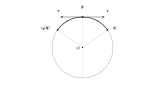
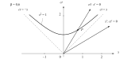
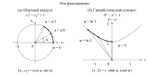
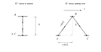
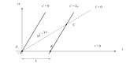
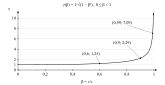
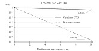

# Псевдоевклидово пространство и локальная симметрия сферы

Дифференциальная геометрия и основы тензорного исчисления. Вариант №9.

## Введение

Геометрия изучает свойства пространств и преобразования, при которых эти свойства сохраняются. Привычные представления о расстоянии и угле связаны с евклидовой геометрией. При рассмотрении других пространств и кривых поверхностей способы измерения требуют уточнения. Это позволяет исследовать как различия между геометрическими моделями, так и общие для них закономерности.

Геометрические методы применяются при изучении поверхностей, в геодезии и навигации. В специальной теории относительности они позволяют рассматривать пространственные и временные характеристики движения в единой математической модели. Такой подход удобен при сопоставлении наблюдений, выполненных в движущихся относительно друг друга системах отсчёта: он помогает отделить свойства самой модели от способа выбора координат.

**Цель курсовой работы** — изучить основные свойства псевдоевклидова пространства и геометрию сферы, а также рассмотреть применение псевдоевклидовой геометрии в специальной теории относительности.

Для достижения цели необходимо ввести используемые формы и преобразования, исследовать кривизну и локальную симметрию сферы и рассмотреть прикладное значение изученных геометрических свойств. Теоретическая часть строится на стандартных положениях линейной алгебры и дифференциальной геометрии. Приложение содержит последовательную запись основных вычислений.

## 1. ПСЕВДОЕВКЛИДОВО ПРОСТРАНСТВО И ЕГО ИЗОМЕТРИИ

### 1.1. Билинейная форма и её матрица

Обозначим множество **вещественных чисел** через $\mathbb R$. **Функция**, или **отображение**, сопоставляет каждому элементу своей **области определения** единственное значение — его **образ**; аргумент является **прообразом** значения. Работаем в **вещественном линейном пространстве** $V$. Его элементы — **векторы**, числовые множители при них — **скаляры** из $\mathbb R$; **нулевой вектор** обозначаем $\mathbf{0}$. Векторы далее пишутся жирным, их координаты и матрицы — обычным шрифтом.

**Линейная комбинация** векторов — сумма их произведений на скаляры. Система векторов **линейно независима**, если её нулевая линейная комбинация имеет только нулевые коэффициенты:
```math
\sum_{i=1}^{n}\alpha_i\mathbf{e}_i=\mathbf{0}
\quad\Longrightarrow\quad \alpha_1=\cdots=\alpha_n=0.
```
**Базис** — линейно независимая система, через которую каждый вектор выражается линейной комбинацией. Число векторов в базисе называется **размерностью** пространства. Коэффициенты разложения — **координаты вектора**:
```math
\dim V=n,\qquad \mathbf{u}=\sum_{i=1}^{n}x^i\mathbf{e}_i,\qquad
\mathbf{v}=\sum_{i=1}^{n}y^i\mathbf{e}_i.
```
Верхний индекс здесь нумерует координату.

**Билинейная форма** на $V$ — функция от пары векторов, линейная по каждому аргументу. Знак $\times$ означает **декартово произведение**. Для $\mathbf{u},\mathbf{v},\mathbf{w}\in V$ и $\alpha,\beta\in\mathbb R$ её область определения и **линейность** записываются так:
```math
\begin{aligned}
g&:V\times V\to\mathbb R,\\
g(\alpha\mathbf{u}+\beta\mathbf{v},\mathbf{w})
&=\alpha g(\mathbf{u},\mathbf{w})+\beta g(\mathbf{v},\mathbf{w}),\\
g(\mathbf{u},\alpha\mathbf{v}+\beta\mathbf{w})
&=\alpha g(\mathbf{u},\mathbf{v})+\beta g(\mathbf{u},\mathbf{w}),
\end{aligned}
```
Форма **симметрична**, если перестановка аргументов не меняет её значения. Векторы **ортогональны**, если значение формы на них равно нулю:
```math
g(\mathbf{u},\mathbf{v})=g(\mathbf{v},\mathbf{u}),\qquad
\mathbf{u}\perp\mathbf{v}\ \Longleftrightarrow\ g(\mathbf{u},\mathbf{v})=0.
```
Форма **невырожденна**, если только нулевой вектор ортогонален каждому вектору пространства:
```math
\bigl(\forall\mathbf{v}\in V\quad g(\mathbf{u},\mathbf{v})=0\bigr)
\quad\Longrightarrow\quad\mathbf{u}=\mathbf{0}.
```
Символ $\forall$ — **квантор всеобщности**. *Далее рассматриваются симметричные невырожденные формы.*

**Матрица** — прямоугольная таблица чисел; **квадратная матрица** имеет одинаковое число строк и столбцов. **Транспонирование** меняет местами строки и столбцы и обозначается знаком ${}^{\mathsf T}$. Обозначим координатные столбцы через $\mathbf{x},\mathbf{y}$. **Матрица формы** и её **элементы** задаются равенствами
```math
\begin{gathered}
\mathbf{x}=(x^1,\ldots,x^n)^{\mathsf T},\qquad
\mathbf{y}=(y^1,\ldots,y^n)^{\mathsf T},\\
G=(g_{ij}),\qquad g_{ij}=g(\mathbf{e}_i,\mathbf{e}_j).
\end{gathered}
```
Из билинейности следует
```math
g(\mathbf{u},\mathbf{v})=\sum_{i,j=1}^{n}g_{ij}x^iy^j
=\mathbf{x}^{\mathsf T}G\mathbf{y},\qquad G^{\mathsf T}=G.
```
Равенство $G^{\mathsf T}=G$ означает, что матрица **симметрична**. При **умножении матриц** элемент произведения получается суммированием произведений элементов соответствующих строки первой и столбца второй матрицы.
**Главная диагональ** квадратной матрицы состоит из элементов с одинаковыми номерами строки и столбца. **Определитель** квадратной матрицы обозначаем $\det G$. Матрица **обратима**, если существует **обратная матрица** $G^{-1}$, произведение с которой в обоих порядках равно **единичной матрице** $E_n$; её диагональные элементы равны единице, остальные — нулю. Для матрицы формы невырожденность равносильна условию
```math
\det G\ne0,\qquad GG^{-1}=G^{-1}G=E_n.
```
При **смене базиса** столбцы обратимой **матрицы перехода** $C$ — координаты нового базиса в старом. Тогда
```math
\begin{aligned}
\mathbf{x}&=C\mathbf{x}',\qquad
\mathbf{x}^{\mathsf T}G\mathbf{y}
=\mathbf{x}'^{\mathsf T}C^{\mathsf T}GC\mathbf{y}',\\
G'&=C^{\mathsf T}GC.
\end{aligned}
```

### 1.2. Сигнатура и изотропные векторы

**Закон инерции Сильвестра** утверждает, что существует базис, в котором матрица симметричной невырожденной формы диагональна и содержит $p$ единиц и $q$ минус единиц; эти числа не зависят от выбора такого базиса. **Диагональная матрица** имеет нулевые элементы вне главной диагонали; её запись обозначаем $\operatorname{diag}$. Следовательно,
```math
\begin{aligned}
G&=J_{p,q}=\operatorname{diag}(E_p,-E_q),\qquad p+q=n,\\
g(\mathbf{u},\mathbf{u})&=\sum_{i=1}^{p}(x^i)^2-\sum_{i=p+1}^{n}(x^i)^2.
\end{aligned}
```
Здесь $E_p$ и $E_q$ — единичные матрицы соответствующих размеров. Пара $(p,q)$ называется **сигнатурой формы**. Вторая строка задаёт соответствующую **квадратичную форму** — значение билинейной формы на паре одинаковых векторов.

**Псевдоевклидово линейное пространство** — пара $(V,g)$, состоящая из вещественного линейного пространства и симметричной невырожденной билинейной формы. При $q=0$ она **положительно определена**: её значение на любом ненулевом векторе положительно. В этом случае $g$ называется **скалярным произведением**, а пространство — **евклидовым**. Если $p,q>0$, форма **неопределённа**, то есть принимает значения обоих знаков на квадратах векторов.

Ненулевой вектор называется **изотропным**, если значение квадратичной формы на нём равно нулю; порождённая им прямая называется **изотропным направлением**. На плоскости с координатами $(X,x)$ рассмотрим форму
```math
\begin{aligned}
g\bigl((X,x),(Y,y)\bigr)&=XY-xy,\\
g(\mathbf{u},\mathbf{u})=0,
\quad\mathbf{u}=(X,x)\ne\mathbf{0}
&\quad\Longleftrightarrow\quad x=\pm X.
\end{aligned}
```
Матрица $\operatorname{diag}(1,-1)$ невырожденна, хотя вектор $(1,1)$ изотропен. Таким образом, нулевое значение на отдельном ненулевом векторе не означает вырожденности формы. Найденные изотропные направления сохраняются изометриями; это будет проверено для преобразований данной плоскости в разделе 1.4.

### 1.3. Ортогональное дополнение и изометрии

**Подпространство** $W\subset V$ содержит нулевой вектор и замкнуто относительно линейных комбинаций. Его **ортогональное дополнение** состоит из векторов, ортогональных каждому вектору $W$:
```math
W^\perp=\{\mathbf{u}\in V:\forall\mathbf{w}\in W\quad
g(\mathbf{u},\mathbf{w})=0\},\qquad
\dim W^\perp=n-\dim W.
```
**Ограничение формы** $g|_W$ означает, что оба аргумента берутся из $W$. **Прямая сумма** подпространств означает единственность представления каждого вектора суммой их элементов. **Пересечение множеств** $W\cap W^\perp$ состоит из их общих элементов. Для невырожденной формы справедливо
```math
\begin{aligned}
V=W\oplus W^\perp
&\quad\Longleftrightarrow\quad W\cap W^\perp=\{\mathbf{0}\}\\
&\quad\Longleftrightarrow\quad g|_W\text{ невырожденна}.
\end{aligned}
```
Это условие выполняется не для любого $W$. На рассмотренной плоскости для изотропной прямой имеем
```math
W=\{(t,t):t\in\mathbb R\},\qquad W^\perp=W.
```

**Линейное преобразование** сохраняет линейные комбинации. Оно называется **линейной изометрией**, если сохраняет форму. Тем же символом $L$ обозначим его матрицу:
```math
\begin{aligned}
g(L\mathbf{u},L\mathbf{v})&=g(\mathbf{u},\mathbf{v})
\quad(\forall\mathbf{u},\mathbf{v}\in V)\\
&\quad\Longleftrightarrow\quad L^{\mathsf T}GL=G.
\end{aligned}
```
Сравнивая определители, получаем
```math
(\det L)^2\det G=\det G\quad\Longrightarrow\quad \det L=\pm1.
```
Следовательно, $L$ обратимо. В базисе с матрицей формы $J_{p,q}$ множество этих преобразований обозначается
```math
O(p,q)=\{L\in GL(n,\mathbb R):L^{\mathsf T}J_{p,q}L=J_{p,q}\}.
```
Здесь $GL(n,\mathbb R)$ — множество обратимых вещественных матриц размера $n\times n$. **Композиция отображений** — последовательное применение; её **ассоциативность** означает независимость результата от расстановки скобок. **Тождественное преобразование** оставляет векторы на месте, **обратное преобразование** отменяет исходное. Композиция изометрий остаётся изометрией: это **замкнутость** относительно композиции. Обратные изометрии также существуют. Такая ассоциативная операция с тождественным и обратными элементами задаёт **группу** $O(p,q)$.

При $G=E_n$ матричное условие изометрии задаёт **ортогональную матрицу**:
```math
Q^{\mathsf T}Q=E_n.
```
Такая матрица сохраняет евклидово скалярное произведение.
В $\mathbb R^2$ и $\mathbb R^3$ ортогональное преобразование с определителем $1$ является **поворотом**.

В **аффинном пространстве** разности точек являются векторами из $V$, а выделенного начала координат нет. После выбора начала **радиус-вектор** соединяет его с соответствующей точкой; обозначим радиус-векторы точек через $\mathbf{x},\mathbf{y}$. **Квадрат интервала** и сохраняющее его **аффинное преобразование** имеют вид
```math
\begin{aligned}
s^2(P,Q)&=g(\overrightarrow{PQ},\overrightarrow{PQ}),\\
F(\mathbf{x})&=L\mathbf{x}+\mathbf{d},\\
F(\mathbf{y})-F(\mathbf{x})&=L(\mathbf{y}-\mathbf{x}).
\end{aligned}
```
Здесь $\mathbf{d}$ — постоянный вектор **переноса**, а $L$ — линейная изометрия. Величина, сохраняющаяся при рассматриваемых преобразованиях, называется **инвариантом**; квадрат интервала является таким инвариантом.

### 1.4. Изометрии псевдоевклидовой плоскости

Найдём семейство линейных изометрий рассмотренной плоскости. Зададим **параметр** $b\in(-1,1)$, то есть число, от которого зависит преобразование. Потребуем, чтобы прямая $x=bX$ переходила в ось $x'=0$. Искомое преобразование запишем в виде
```math
x'=A(x-bX),\qquad X'=BX+Dx,
```
где $A,B,D$ зависят от $b$. Условие сохранения формы должно выполняться при любых $X,x$:
```math
(BX+Dx)^2-A^2(x-bX)^2=X^2-x^2.
```
Сравнение коэффициентов при $X^2$, $x^2$ и $Xx$ приводит к системе
```math
\begin{aligned}
B^2-A^2b^2&=1,\\
D^2-A^2&=-1,\\
BD+A^2b&=0.
\end{aligned}
```
Из первого равенства $B\ne0$. Подставляя $D=-A^2b/B$ во второе, получаем
```math
A^2(B^2-A^2b^2)=B^2
\quad\Longrightarrow\quad A^2=B^2\ne0.
```
Выберем непрерывное семейство, тождественное при $b=0$. **Предел** функции — число, к которому сколь угодно близки её значения при достаточно близких к заданной точке аргументах, отличных от самой точки. **Непрерывность** означает совпадение предела со значением функции. Поскольку $A(0)=B(0)=1$, а $A,B$ непрерывны и ненулевые на $(-1,1)$, их знаки положительны. Следовательно,
```math
A=B>0,\qquad D=-Ab,\qquad A^2(1-b^2)=1,\qquad
A=B=\frac{1}{\sqrt{1-b^2}}.
```
Искомая изометрия имеет вид
```math
\begin{aligned}
X'&=\frac{X-bx}{\sqrt{1-b^2}},\\
x'&=\frac{x-bX}{\sqrt{1-b^2}}.
\end{aligned}
```
Прямая проверка даёт
```math
X'^2-x'^2=\frac{(X-bx)^2-(x-bX)^2}{1-b^2}=X^2-x^2.
```
В частности, изотропные направления переходят в себя:
```math
x=X\ \Longrightarrow\ x'=X',\qquad
x=-X\ \Longrightarrow\ x'=-X'.
```
Обратное преобразование получается заменой $b$ на $-b$.

**Экспонента** $\exp\psi=e^\psi$ и **натуральный логарифм** $\ln$ — взаимно обратные функции. Введём **гиперболические косинус, синус и тангенс**:
```math
\cosh\psi=\frac{e^\psi+e^{-\psi}}2,\qquad
\sinh\psi=\frac{e^\psi-e^{-\psi}}2,\qquad
\tanh\psi=\frac{\sinh\psi}{\cosh\psi}.
```
Для каждого $b\in(-1,1)$ существует единственный $\psi\in\mathbb R$, для которого
```math
b=\tanh\psi,\qquad
\frac1{\sqrt{1-b^2}}=\cosh\psi,\qquad
\frac b{\sqrt{1-b^2}}=\sinh\psi.
```
В порядке координат $(X,x)$ матрица преобразования равна
```math
\begin{pmatrix}X'\\x'\end{pmatrix}
=\Lambda(\psi)\begin{pmatrix}X\\x\end{pmatrix},\qquad
\Lambda(\psi)=
\begin{pmatrix}
\cosh\psi&-\sinh\psi\\
-\sinh\psi&\cosh\psi
\end{pmatrix}.
```
Это **гиперболический поворот**. По формулам сложения гиперболических функций
```math
\Lambda(\psi_2)\Lambda(\psi_1)=\Lambda(\psi_1+\psi_2),\qquad
\Lambda(\psi)^{-1}=\Lambda(-\psi).
```
**Орбита** — множество образов вектора при всех преобразованиях семейства. Для вектора $(1,0)$ получаем ветвь **гиперболы**:
```math
(X,x)=(\cosh\psi,-\sinh\psi),\qquad X^2-x^2=1,\qquad X>0.
```

## 2. ГЕОМЕТРИЯ И ЛОКАЛЬНАЯ СИММЕТРИЯ СФЕРЫ

### 2.1. Поверхность и риманова метрика

**Производная** функции одной переменной — предел отношения её приращения к приращению аргумента:
```math
f'(t)=\lim_{h\to0}\frac{f(t+h)-f(t)}{h}.
```
**Частная производная** вычисляется по переменной $x^i$ при фиксированных остальных переменных:
```math
\partial_i f=\frac{\partial f}{\partial x^i}.
```
**Гладкость** функции означает существование непрерывных частных производных всех порядков; для отображения это условие относится к каждой координатной функции.

**Открытое множество** $U\subset\mathbb R^2$ вместе с каждой своей точкой содержит некоторый круг с центром в этой точке. Открытое множество, содержащее выбранную точку, будем называть её **окрестностью**. Отображение **взаимно однозначно**, если каждой точке его образа соответствует ровно один прообраз. **Гладкая поверхность** $M\subset\mathbb R^3$ в окрестности каждой точки допускает **параметризацию** $\mathbf{r}:U\to M$: гладкое взаимно однозначное отображение с непрерывным обратным, у которого векторы частных производных линейно независимы. Образ параметризации называется **координатным участком**, а обратное отображение задаёт **координатную карту** поверхности.

**Покрытие** поверхности — набор координатных участков, **объединение** которых даёт всю поверхность. Знак $\bigcup$ обозначает объединение, содержащее элементы хотя бы одного из объединяемых множеств.

Точку поверхности отождествляем с её радиус-вектором. **Касательная плоскость** $T_{\mathbf{p}}M$ состоит из линейных комбинаций **координатных касательных векторов**:
```math
\begin{aligned}
\mathbf{p}&=\mathbf{r}(x^1,x^2),\qquad
\mathbf{e}_i=\frac{\partial\mathbf{r}}{\partial x^i},\\
T_{\mathbf{p}}M&=\{v^1\mathbf{e}_1+v^2\mathbf{e}_2:v^1,v^2\in\mathbb R\}.
\end{aligned}
```
В $\mathbb R^3$ используем евклидово скалярное произведение и соответствующую **норму**, то есть длину вектора:
```math
\langle\mathbf{u},\mathbf{v}\rangle=\sum_{i=1}^{3}u^iv^i,
\qquad \|\mathbf{u}\|=\sqrt{\langle\mathbf{u},\mathbf{u}\rangle}.
```
**Риманова метрика** $g$ — положительно определённая симметричная билинейная форма на каждой касательной плоскости, гладко зависящая от точки. Для поверхности в евклидовом пространстве **индуцированная метрика** получается ограничением скалярного произведения на касательные векторы. Индексы $i,j,k,l,m$ далее принимают значения $1,2$. Используем **соглашение о суммировании**: индекс, повторённый один раз сверху и один раз снизу, означает сумму по его значениям. **Матрица метрики**, её обратная матрица и квадрат **элемента длины** записываются в виде
```math
\begin{aligned}
g_{ij}&=g(\mathbf{e}_i,\mathbf{e}_j)=\langle\mathbf{r}_{x^i},\mathbf{r}_{x^j}\rangle,\\
G&=(g_{ij}),\qquad (g^{ij})=G^{-1},\qquad
ds^2=g_{ij}\,dx^i dx^j.
\end{aligned}
```
Коэффициенты $g^{ij}$ образуют **обратную метрику**. Здесь $dx^i$ — **дифференциалы координат**. **Символ Кронекера** $\delta^i{}_j$ равен единице при совпадающих индексах и нулю иначе:
```math
\delta^i{}_j=
\begin{cases}1,&i=j,\\0,&i\ne j,\end{cases}
\qquad g^{ik}g_{kj}=\delta^i{}_j.
```
Для гладкой функции $F$ в $\mathbb R^3$ **дифференциал** $dF_{\mathbf{p}}$ задаёт линейную часть её приращения, а **градиент** $\operatorname{grad}F$ — вектор первых частных производных:
```math
\operatorname{grad}F=(\partial_1F,\partial_2F,\partial_3F)^{\mathsf T},
\qquad dF_{\mathbf{p}}(\mathbf{v})=
\langle\operatorname{grad}F(\mathbf{p}),\mathbf{v}\rangle.
```
Уравнение $F=0$ определяет **регулярную поверхность уровня** там, где градиент не равен нулю. **Ядро линейного отображения** состоит из векторов, которые оно переводит в нуль. Касательная плоскость поверхности уровня является ядром дифференциала:
```math
T_{\mathbf{p}}M=\ker dF_{\mathbf{p}}
=\{\mathbf{v}:dF_{\mathbf{p}}(\mathbf{v})=0\}.
```

### 2.2. Связность, кривизна и геодезические

**Векторное поле** $\mathbf{X}$ сопоставляет каждой точке поверхности касательный вектор. Его координаты предполагаются гладкими; **производная по направлению** поля определяется равенством
```math
\mathbf{X}=X^i\mathbf{e}_i,\qquad
\mathbf{X}(f)=X^i\partial_i f.
```
**Ковариантная производная**, или **связность**, $\nabla_{\mathbf{X}}\mathbf{Y}$ дифференцирует поле $\mathbf{Y}$ вдоль $\mathbf{X}$ с учётом изменения касательного базиса. Она линейна по $\mathbf{X}$ над гладкими функциями, линейна по $\mathbf{Y}$ над $\mathbb R$ и удовлетворяет **правилу Лейбница**
```math
\nabla_{\mathbf{X}}(f\mathbf{Y})=\mathbf{X}(f)\mathbf{Y}+f\nabla_{\mathbf{X}}\mathbf{Y}.
```
**Коммутатор векторных полей** задаётся их действием на гладкую функцию:
```math
[\mathbf{X},\mathbf{Y}](f)=\mathbf{X}(\mathbf{Y}(f))-\mathbf{Y}(\mathbf{X}(f)),
\qquad [\mathbf{e}_i,\mathbf{e}_j]=\mathbf{0}.
```
**Связность Леви-Чивиты** — единственная ковариантная производная, согласованная с метрикой и не имеющая **кручения**. Эти два условия означают
```math
\begin{aligned}
\mathbf{X}\bigl(g(\mathbf{Y},\mathbf{Z})\bigr)
&=g(\nabla_{\mathbf{X}}\mathbf{Y},\mathbf{Z})
+g(\mathbf{Y},\nabla_{\mathbf{X}}\mathbf{Z}),\\
\nabla_{\mathbf{X}}\mathbf{Y}-\nabla_{\mathbf{Y}}\mathbf{X}
-[\mathbf{X},\mathbf{Y}]&=\mathbf{0}.
\end{aligned}
```
Первое условие означает **согласованность связности с метрикой** и кратко записывается как
```math
\nabla g=0.
```
Левая часть второго равенства и есть кручение связности. **Символы Кристоффеля** $\Gamma^k{}_{ij}$ — координатные коэффициенты этой производной:
```math
\nabla_{\mathbf{e}_i}\mathbf{e}_j=\Gamma^k{}_{ij}\mathbf{e}_k,
\qquad \Gamma^k{}_{ij}=\Gamma^k{}_{ji}.
```
Они вычисляются по метрике:
```math
\Gamma^k{}_{ij}=\frac12g^{k\ell}
\left(\partial_i g_{j\ell}+\partial_j g_{i\ell}-\partial_\ell g_{ij}\right).
```
Используемые далее **тензоры** задаются в каждой касательной плоскости **многолинейными отображениями**, то есть отображениями, линейными по каждому аргументу. Их значения являются числами или касательными векторами; гладкая зависимость от точки даёт **тензорное поле**. **Тензор кривизны** характеризует различие результатов последовательного ковариантного дифференцирования. Примем соглашение о знаке
```math
R(\mathbf{X},\mathbf{Y})\mathbf{Z}
=\nabla_{\mathbf{X}}\nabla_{\mathbf{Y}}\mathbf{Z}
-\nabla_{\mathbf{Y}}\nabla_{\mathbf{X}}\mathbf{Z}
-\nabla_{[\mathbf{X},\mathbf{Y}]}\mathbf{Z}.
```
Его **компоненты** — коэффициенты в координатном базисе:
```math
R(\mathbf{e}_i,\mathbf{e}_j)\mathbf{e}_k=R^l{}_{kij}\mathbf{e}_l.
```
Подстановка координатного выражения связности даёт
```math
R^l{}_{kij}=\partial_i\Gamma^l{}_{jk}-\partial_j\Gamma^l{}_{ik}
+\Gamma^m{}_{jk}\Gamma^l{}_{im}-\Gamma^m{}_{ik}\Gamma^l{}_{jm}.
```
Метрика называется **плоской**, если её тензор кривизны равен нулю.
Перестановка $i,j$ меняет знак компоненты; это свойство называется **кососимметрией**. **Свёртка тензора** означает суммирование по одному верхнему и одному нижнему индексам. Так получаются **тензор Риччи** и затем **скалярная кривизна**:
```math
\operatorname{Ric}_{kj}=\sum_i R^i{}_{kij},\qquad
\operatorname{Scal}=\sum_{k,j}g^{kj}\operatorname{Ric}_{kj}.
```
**Гауссова кривизна** $K$ поверхности определяется для линейно независимых $\mathbf{X},\mathbf{Y}\in T_{\mathbf{p}}M$ формулой
```math
K=\frac{g(R(\mathbf{X},\mathbf{Y})\mathbf{Y},\mathbf{X})}
{g(\mathbf{X},\mathbf{X})g(\mathbf{Y},\mathbf{Y})-g(\mathbf{X},\mathbf{Y})^2}.
```
Значение не зависит от выбора базиса $\mathbf{X},\mathbf{Y}$ двумерной касательной плоскости.

**Кривая** $\boldsymbol{\gamma}(t)$ на поверхности — гладкое отображение интервала параметра $t$ в поверхность. Точка над $\boldsymbol{\gamma}$ обозначает производную по $t$, то есть её касательный вектор. Поле $\mathbf{V}$ вдоль кривой **параллельно**, если его ковариантная производная вдоль неё равна нулю. **Геодезическая** — кривая, у которой параллелен собственный касательный вектор:
```math
\begin{aligned}
\nabla_{\dot{\boldsymbol{\gamma}}}\mathbf{V}&=\mathbf{0}
\quad\text{для параллельного поля},\\
\nabla_{\dot{\boldsymbol{\gamma}}}\dot{\boldsymbol{\gamma}}&=\mathbf{0}
\quad\text{для геодезической}.
\end{aligned}
```
При заданных **начальных данных** — начальной точке и касательном векторе — геодезическая в достаточно малом интервале параметра существует и единственна.

Дифференциал отображения поверхности $s$ переводит касательные векторы в касательные векторы; его обозначаем $(ds)_{\mathbf{p}}$. **Локальная изометрия** — гладкое взаимно однозначное отображение окрестностей с гладким обратным, сохраняющее метрику посредством дифференциала:
```math
g_{s(\mathbf{p})}\bigl((ds)_{\mathbf{p}}\mathbf{v},(ds)_{\mathbf{p}}\mathbf{w}\bigr)
=g_{\mathbf{p}}(\mathbf{v},\mathbf{w}).
```
**Геодезическая симметрия** в точке $\mathbf{p}$ обращает направление каждой геодезической через эту точку:
```math
s_{\mathbf{p}}(\boldsymbol{\gamma}(t))=\boldsymbol{\gamma}(-t),
\qquad \boldsymbol{\gamma}(0)=\mathbf{p}.
```
Она определяется в достаточно малой окрестности $\mathbf{p}$. Поверхность называется **локально симметричной**, если в каждой её точке геодезическая симметрия является локальной изометрией.

### 2.3. Вычисление метрики сферы

Вычислим кривизну сферы постоянного радиуса $a>0$ с метрикой, индуцированной евклидовым скалярным произведением; для сферы из задания положим $a=1$.

Сфера радиуса $a$ является поверхностью уровня функции $F$:
```math
\begin{aligned}
S_a^2&=\{\mathbf{x}\in\mathbb R^3:\langle\mathbf{x},\mathbf{x}\rangle=a^2\},\\
F(\mathbf{x})&=\langle\mathbf{x},\mathbf{x}\rangle-a^2,
\qquad \operatorname{grad}F(\mathbf{p})=2\mathbf{p}\ne\mathbf{0}.
\end{aligned}
```
Поэтому сфера регулярна. Касательные векторы принадлежат ядру дифференциала, то есть множеству векторов, которые он переводит в нуль:
```math
\begin{aligned}
dF_{\mathbf{p}}(\mathbf{v})&=2\langle\mathbf{p},\mathbf{v}\rangle,\\
T_{\mathbf{p}}S_a^2&=\{\mathbf{v}:\langle\mathbf{p},\mathbf{v}\rangle=0\}
=\mathbf{p}^{\perp},
\qquad g_{\mathbf{p}}(\mathbf{v},\mathbf{w})=\langle\mathbf{v},\mathbf{w}\rangle.
\end{aligned}
```
Метрика положительно определена на всей сфере:
```math
g_{\mathbf{p}}(\mathbf{v},\mathbf{v})=\|\mathbf{v}\|^2>0
\qquad (\mathbf{0}\ne\mathbf{v}\in T_{\mathbf{p}}S_a^2).
```
В сферических координатах $x^1=\theta$, $x^2=\varphi$ возьмём параметризацию
```math
\begin{gathered}
\mathbf{r}(\theta,\varphi)=a(\sin\theta\cos\varphi,\sin\theta\sin\varphi,\cos\theta),\\
0<\theta<\pi,\qquad \alpha<\varphi<\alpha+2\pi.
\end{gathered}
```
Здесь $\theta$ — угол радиус-вектора с полярной осью, $\varphi$ — угол его проекции в перпендикулярной плоскости, а $\alpha$ фиксирует положение меридианного разреза. Координатный участок исключает полюса и меридиан $\varphi=\alpha$; в указанной области параметризация взаимно однозначна. Дифференцирование даёт
```math
\begin{aligned}
\mathbf{r}_\theta&=a(\cos\theta\cos\varphi,\cos\theta\sin\varphi,-\sin\theta),\\
\mathbf{r}_\varphi&=a(-\sin\theta\sin\varphi,\sin\theta\cos\varphi,0).
\end{aligned}
```
Скалярные произведения координатных векторов равны
```math
\begin{aligned}
g_{\theta\theta}
&=a^2\bigl(\cos^2\theta(\cos^2\varphi+\sin^2\varphi)+\sin^2\theta\bigr)=a^2,\\
g_{\theta\varphi}
&=a^2\cos\theta\sin\theta(-\cos\varphi\sin\varphi+\sin\varphi\cos\varphi)=0,\\
g_{\varphi\varphi}
&=a^2\sin^2\theta(\sin^2\varphi+\cos^2\varphi)=a^2\sin^2\theta.
\end{aligned}
```
Следовательно,
```math
G=\operatorname{diag}(a^2,a^2\sin^2\theta),\qquad
ds^2=a^2(d\theta^2+\sin^2\theta\,d\varphi^2),
```
```math
\det G=a^4\sin^2\theta>0,\qquad
G^{-1}=\operatorname{diag}\left(a^{-2},(a^2\sin^2\theta)^{-1}\right).
```
При $a>0$, $0<\theta<\pi$ координатные векторы линейно независимы; деления на $a$ и $\sin\theta$ допустимы.

### 2.4. Вычисление связности и кривизны

Единственная не тождественно нулевая производная метрики имеет вид
```math
\partial_\theta g_{\varphi\varphi}=2a^2\sin\theta\cos\theta.
```
Подстановка в формулу символов Кристоффеля даёт
```math
\begin{aligned}
\Gamma^\theta{}_{\varphi\varphi}
&=-\frac12g^{\theta\theta}\partial_\theta g_{\varphi\varphi}
=-\frac1{2a^2}\,2a^2\sin\theta\cos\theta
=-\sin\theta\cos\theta,\\
\Gamma^\varphi{}_{\theta\varphi}
&=\frac12g^{\varphi\varphi}\partial_\theta g_{\varphi\varphi}
=\frac{2a^2\sin\theta\cos\theta}{2a^2\sin^2\theta}
=\cot\theta.
\end{aligned}
```
Здесь $\cot\theta=\cos\theta/\sin\theta$ — котангенс. По симметрии нижних индексов $\Gamma^\varphi{}_{\varphi\theta}=\cot\theta$; остальные символы равны нулю. Применяя координатную формулу тензора кривизны, получаем
```math
\begin{aligned}
R^\theta{}_{\varphi\theta\varphi}
&=\partial_\theta\Gamma^\theta{}_{\varphi\varphi}
-\Gamma^\varphi{}_{\theta\varphi}\Gamma^\theta{}_{\varphi\varphi}\\
&=\partial_\theta(-\sin\theta\cos\theta)
-\cot\theta(-\sin\theta\cos\theta)\\
&=\sin^2\theta-\cos^2\theta+\cos^2\theta=\sin^2\theta,\\[2mm]
R^\varphi{}_{\theta\varphi\theta}
&=-\partial_\theta\Gamma^\varphi{}_{\theta\varphi}
-(\Gamma^\varphi{}_{\theta\varphi})^2\\
&=-\partial_\theta(\cot\theta)-\cot^2\theta
=\frac1{\sin^2\theta}-\frac{\cos^2\theta}{\sin^2\theta}=1.
\end{aligned}
```
Оставшиеся компоненты при $(i,j)=(\theta,\varphi)$:
```math
R^\theta{}_{\theta\theta\varphi}=0,\qquad
R^\varphi{}_{\varphi\theta\varphi}=-\partial_\varphi(\cot\theta)=0.
```
При $i=j$ компоненты нулевые, перестановка $i,j$ меняет знак. Тем самым определены все компоненты, в частности
```math
\begin{aligned}
R(\mathbf{e}_\theta,\mathbf{e}_\varphi)\mathbf{e}_\theta
&=-\mathbf{e}_\varphi,\\
R(\mathbf{e}_\theta,\mathbf{e}_\varphi)\mathbf{e}_\varphi
&=\sin^2\theta\,\mathbf{e}_\theta.
\end{aligned}
```
Для $\mathbf{X}=\mathbf{e}_\theta$, $\mathbf{Y}=\mathbf{e}_\varphi$ определение гауссовой кривизны даёт
```math
K=\frac{g(\sin^2\theta\,\mathbf{e}_\theta,\mathbf{e}_\theta)}
{g_{\theta\theta}g_{\varphi\varphi}-g_{\theta\varphi}^2}
=\frac{a^2\sin^2\theta}{a^4\sin^2\theta}
=\frac1{a^2}.
```
Свёртка тензора кривизны приводит к
```math
\begin{aligned}
\operatorname{Ric}_{\theta\theta}&=R^\varphi{}_{\theta\varphi\theta}=1,\\
\operatorname{Ric}_{\varphi\varphi}&=R^\theta{}_{\varphi\theta\varphi}=\sin^2\theta,\\
\operatorname{Ric}_{\theta\varphi}&=\operatorname{Ric}_{\varphi\theta}=0.
\end{aligned}
```
Следовательно,
```math
(\operatorname{Ric}_{ij})=\operatorname{diag}(1,\sin^2\theta),
\qquad \operatorname{Ric}=\frac1{a^2}g.
```
Сворачивая с обратной метрикой, получаем скалярную кривизну:
```math
\operatorname{Scal}
=g^{\theta\theta}\operatorname{Ric}_{\theta\theta}
+g^{\varphi\varphi}\operatorname{Ric}_{\varphi\varphi}
=\frac1{a^2}+\frac{\sin^2\theta}{a^2\sin^2\theta}
=\frac2{a^2}=2K.
```

### 2.5. Кривизна на всей сфере и её ковариантная производная

При $\theta=0,\pi$ вырождается формула выбранной параметризации, а не метрика на $\mathbf{p}^{\perp}$. Для каждой точки можно выбрать полярную ось и разрез, не содержащие эту точку. Ортогональная матрица $Q$ сохраняет евклидово скалярное произведение; повёрнутая параметризация имеет ту же метрику:
```math
Q^{\mathsf T}Q=E_3,\qquad
\widetilde{\mathbf{r}}=Q\mathbf{r},\qquad
\langle Q\mathbf{r}_{x^i},Q\mathbf{r}_{x^j}\rangle
=\langle\mathbf{r}_{x^i},\mathbf{r}_{x^j}\rangle.
```
Соответствующие координатные участки покрывают сферу и распространяют полученные тензорные результаты на всю $S_a^2$.

Проверим по вычисленным компонентам равенство
```math
R(\mathbf{X},\mathbf{Y})\mathbf{Z}
=\frac1{a^2}\bigl(g(\mathbf{Y},\mathbf{Z})\mathbf{X}
-g(\mathbf{X},\mathbf{Z})\mathbf{Y}\bigr).
```
При $\mathbf{X}=\mathbf{e}_\theta$, $\mathbf{Y}=\mathbf{e}_\varphi$ правая часть на двух базисных векторах $\mathbf{Z}$ равна
```math
\begin{aligned}
\mathbf{Z}=\mathbf{e}_\theta:&\qquad
\frac1{a^2}(g_{\varphi\theta}\mathbf{e}_\theta-g_{\theta\theta}\mathbf{e}_\varphi)
=-\mathbf{e}_\varphi,\\
\mathbf{Z}=\mathbf{e}_\varphi:&\qquad
\frac1{a^2}(g_{\varphi\varphi}\mathbf{e}_\theta-g_{\theta\varphi}\mathbf{e}_\varphi)
=\sin^2\theta\,\mathbf{e}_\theta.
\end{aligned}
```
Это совпадает с ранее вычисленным действием $R(\mathbf{e}_\theta,\mathbf{e}_\varphi)$. Обе части кососимметричны по $\mathbf{X},\mathbf{Y}$, при равных базисных аргументах равны нулю; по многолинейности равенство верно для любых $\mathbf{X},\mathbf{Y},\mathbf{Z}$. Проверка применима в каждой из повёрнутых параметризаций. В координатах
```math
R^l{}_{kij}=\frac1{a^2}\left(\delta^l{}_i g_{jk}-\delta^l{}_j g_{ik}\right).
```
Проверим, что ковариантная производная тензора равна нулю. Пусть $\mathbf{W}$ — произвольное гладкое касательное поле. Радиус $a$ постоянен и $\nabla g=0$; полная производная имеет вид
```math
\begin{aligned}
(\nabla_{\mathbf{W}}R)(\mathbf{X},\mathbf{Y})\mathbf{Z}
&=\nabla_{\mathbf{W}}(R(\mathbf{X},\mathbf{Y})\mathbf{Z})
-R(\nabla_{\mathbf{W}}\mathbf{X},\mathbf{Y})\mathbf{Z}\\
&\quad-R(\mathbf{X},\nabla_{\mathbf{W}}\mathbf{Y})\mathbf{Z}
-R(\mathbf{X},\mathbf{Y})(\nabla_{\mathbf{W}}\mathbf{Z}).
\end{aligned}
```
Здесь учитывается изменение результата $R(\mathbf{X},\mathbf{Y})\mathbf{Z}$ и трёх аргументов. После подстановки выражения для $R$ правило Лейбница сокращает слагаемые с производными полей; остаются только производные метрики:
```math
\begin{aligned}
(\nabla_{\mathbf{W}}R)(\mathbf{X},\mathbf{Y})\mathbf{Z}
&=\frac1{a^2}\bigl((\nabla_{\mathbf{W}}g)(\mathbf{Y},\mathbf{Z})\mathbf{X}
-(\nabla_{\mathbf{W}}g)(\mathbf{X},\mathbf{Z})\mathbf{Y}\bigr)\\
&=\mathbf{0}.
\end{aligned}
```
Следовательно,
```math
\nabla R=0\quad\text{на всей }S_a^2.
```
Это свойство полного тензора: отдельные координатные компоненты могут быть непостоянны.

### 2.6. Доказательство локальной симметричности

Ортогональное преобразование $\mathbb R^3$, сохраняющее сферу, сохраняет и её индуцированную метрику. Для фиксированной точки $\mathbf{p}\in S_a^2$ рассмотрим
```math
s_{\mathbf{p}}(\mathbf{q})
=2\frac{\langle\mathbf{p},\mathbf{q}\rangle}{a^2}\mathbf{p}-\mathbf{q}.
```
Разложим радиус-вектор на составляющие вдоль $\mathbf{p}$ и перпендикулярно ему:
```math
\mathbf{q}=\lambda\mathbf{p}+\mathbf{v},\qquad
\langle\mathbf{p},\mathbf{v}\rangle=0,
\qquad s_{\mathbf{p}}(\mathbf{q})=\lambda\mathbf{p}-\mathbf{v}.
```
Здесь $\lambda\mathbf{p}$ — ортогональная проекция на прямую $\mathbb R\mathbf{p}$, а $\mathbf{v}$ — перпендикулярная составляющая.
Это ортогональный поворот на $\pi$ вокруг прямой $\mathbb R\mathbf{p}$, сохраняющий сферу и метрику. Он фиксирует $\mathbf{p}$, а его дифференциал обращает каждый касательный вектор:
```math
s_{\mathbf{p}}(\mathbf{p})=\mathbf{p},\qquad
(ds_{\mathbf{p}})_{\mathbf{p}}\mathbf{v}=-\mathbf{v}
\quad(\mathbf{v}\in\mathbf{p}^{\perp}).
```
Изометрия переводит геодезическую $\boldsymbol{\gamma}(t)$ с начальными данными $(\mathbf{p},\mathbf{v})$ в геодезическую с данными $(\mathbf{p},-\mathbf{v})$. Кривая $\boldsymbol{\gamma}(-t)$ имеет те же начальные данные. По единственности геодезической
```math
s_{\mathbf{p}}(\boldsymbol{\gamma}(t))=\boldsymbol{\gamma}(-t)
\quad\text{при достаточно малых }t.
```
Следовательно, построенное отображение совпадает с геодезической симметрией и является изометрией.



Рисунок 1 — Геодезическая симметрия сферы

Большая окружность получается пересечением сферы с плоскостью через её центр. В таком сечении (рисунок 1) дуги $\mathbf{p}\mathbf{q}$ и $\mathbf{p}s_{\mathbf{p}}(\mathbf{q})$ имеют равные длины и противоположные начальные направления в $\mathbf{p}$.

Для единичной сферы ($a=1$) получаем
```math
K=1,\qquad \operatorname{Scal}=2,\qquad \nabla R=0.
```
Стандартная сфера $S^2$ с обычной метрикой локально симметрична.

## 3. ПРИМЕНЕНИЕ ПСЕВДОЕВКЛИДОВОЙ ГЕОМЕТРИИ В СТО

### 3.1. Пространство Минковского и интервал

Специальная теория относительности (СТО) описывает пространственные и временные измерения в движущихся системах без учёта гравитации. Система отсчёта включает пространственные координаты и часы, задающие время событий. Инерциальной называется система, в которой тело, не испытывающее внешних воздействий, движется равномерно и прямолинейно. В принятой модели переходы между такими системами аффинны, а скорость света в вакууме $c$ одинакова во всех этих системах.

Событие задаётся местом и временем. Время $t$ в выбранной системе отсчёта называется координатным. Чтобы все четыре координаты имели размерность длины, полагают
```math
\begin{aligned}
x^0&=ct,\qquad x^1=x,\\
x^2&=y,\qquad x^3=z.
\end{aligned}
```
Верхние индексы здесь нумеруют координаты. Пространство событий с формой сигнатуры $(1,3)$ называется пространством Минковского. Для векторов $\mathbf{A},\mathbf{B}$ с компонентами $A^\mu,B^\mu$, где $\mu=0,1,2,3$, форма и её матрица имеют вид
```math
\begin{aligned}
\eta&=\operatorname{diag}(1,-1,-1,-1),\\
\eta(\mathbf{A},\mathbf{B})&=A^0B^0-A^1B^1-A^2B^2-A^3B^3.
\end{aligned}
```
Пространственный радиус-вектор $\mathbf{r}=(x,y,z)$ соединяет начало координат с положением события; $|\mathbf{r}|$ обозначает его евклидову длину. Квадрат интервала между событиями есть значение формы на разности их координат; знак $\Delta$ обозначает разность значений:
```math
\begin{aligned}
\Delta s^2&=c^2(\Delta t)^2-|\Delta\mathbf{r}|^2,\\
ds^2&=c^2dt^2-dx^2-dy^2-dz^2.
\end{aligned}
```
Интервал сохраняется при переходе между инерциальными системами. Ненулевой вектор разности классифицируется по знаку квадрата интервала:
```math
\begin{aligned}
\Delta s^2>0&:\quad\text{времениподобный вектор},\\
\Delta s^2=0&:\quad\text{светоподобный вектор},\\
\Delta s^2<0&:\quad\text{пространственноподобный вектор}.
\end{aligned}
```
Это физические названия уже рассмотренных случаев положительного, нулевого и отрицательного значения квадратичной формы. Изотропные направления образуют световой конус:
```math
|\Delta\mathbf{r}|=c|\Delta t|.
```

### 3.2. Преобразования Лоренца и их геометрический смысл

Пусть система $K'$ движется относительно $K$ с постоянной скоростью вдоль оси $x$. Через $v$ обозначим проекцию скорости на эту ось; $|v|<c$. Оси сонаправлены, начала совпадают при $t=t'=0$, а $y'=y$, $z'=z$. Поэтому перенос отсутствует, и переход определяется линейной изометрией. Положим $X=ct$ и $\beta=v/c$. Начало $K'$ движется по прямой $x=\beta X$; следовательно, условие $x'=0$ совпадает с условием, использованным в разделе 1.4. Подставляя $b=\beta$ в найденное там преобразование и деля $X'$ на $c$, получаем
```math
\begin{gathered}
x'=\gamma(x-vt),\qquad t'=\gamma\left(t-\frac{vx}{c^2}\right),\\
y'=y,\qquad z'=z,\qquad \gamma=\frac1{\sqrt{1-v^2/c^2}}.
\end{gathered}
```
Эти равенства называются преобразованиями Лоренца, а $\gamma$ — коэффициентом Лоренца. Проверенное в разделе 1.4 сохранение $X^2-x^2$ вместе с $y'=y$, $z'=z$ даёт сохранение полного интервала. Для четырёхмерной матрицы перехода $\Lambda$ это означает
```math
\Lambda^{\mathsf T}\eta\Lambda=\eta.
```
Обратное преобразование получается заменой $v$ на $-v$.

На рисунке 2 показано сечение $y=z=0$, $ct\ge0$, при $v=0{,}6c$. Оси $K'$ задаются условиями $x'=0$, то есть $x=\beta ct$, и $t'=0$, то есть $ct=\beta x$. Гипербола $c^2t^2-x^2=1$ объединяет события с одинаковым квадратом интервала от начала координат. В условных единицах точка $P$ с координатами $(x,ct)=(3/4,5/4)$ имеет $(x',ct')=(0,1)$: в обеих системах $s^2=1$.



Рисунок 2 — Диаграмма Минковского

Параметр $\psi$, введённый в разделе 1.4, в СТО называется быстротой. Он связан со скоростью равенствами
```math
\beta=\tanh\psi,\qquad \gamma=\cosh\psi,\qquad \gamma\beta=\sinh\psi.
```
На рисунке 3 сопоставлены обычный поворот, изменяющий направления на один угол и сохраняющий расстояния от центра, и гиперболический поворот. Орбитами отмеченного вектора являются окружность в первом случае и ветвь гиперболы $X^2-x^2=1$, $X>0$, во втором. Образ вектора с координатами $(X,x)=(1,0)$ имеет координаты $(\cosh\psi,-\sinh\psi)$; при горизонтальной оси $x$ и вертикальной $X$ значениям $\psi>0$ соответствуют точки слева. Отмечены $\psi=0,\ln2,\ln3$, масштабы обеих координат одинаковы. Быстрота не равна обычному углу на рисунке.



Рисунок 3 — Орбиты обычного и гиперболического поворотов

Гиперболы на диаграммах являются линиями постоянного интервала. Их форма не означает кривизны пространства: в линейных координатах матрица $\eta$ постоянна, поэтому символы Кристоффеля и тензор кривизны равны нулю. Здесь те же координатные формулы применяются к невырожденной метрике, не требуя её положительной определённости.

Для последовательных переходов вдоль одной оси матрицы перемножаются, а быстроты складываются. Если $K_1$ движется относительно $K$ со скоростью $v_1$, а $K_2$ относительно $K_1$ — со скоростью $v_2$, положим $\beta_i=v_i/c$ и определим $\psi_i$ равенствами $\tanh\psi_i=\beta_i$. Формула сложения гиперболического тангенса даёт
```math
\begin{aligned}
\tanh(\psi_1+\psi_2)&=\frac{\beta_1+\beta_2}{1+\beta_1\beta_2},\\
v&=\frac{v_1+v_2}{1+v_1v_2/c^2}.
\end{aligned}
```
Таким образом, закон сложения скоростей следует из композиции изометрий; при $|v_1|,|v_2|<c$ полученная скорость также удовлетворяет $|v|<c$.

### 3.3. Собственное время и измерение длины

Мировой линией называется кривая, описывающая последовательность событий движения тела. Собственное время $\tau$ — время, показываемое часами, движущимися вместе с телом. Пусть вдоль линии $dt>0$. Вектор скорости и его ограничение имеют вид
```math
\mathbf{u}=\frac{d\mathbf{r}}{dt},\qquad |\mathbf{u}|<c.
```
Из инвариантного соотношения
```math
ds^2=c^2dt^2\left(1-\frac{|\mathbf{u}|^2}{c^2}\right)=c^2d\tau^2
```
получаем
```math
\begin{aligned}
d\tau&=dt\sqrt{1-\frac{|\mathbf{u}|^2}{c^2}},\\
\tau_2-\tau_1&=\int_{t_1}^{t_2}\sqrt{1-\frac{|\mathbf{u}(t)|^2}{c^2}}\,dt.
\end{aligned}
```
Определённый интеграл суммирует приращения собственного времени на промежутке от $t_1$ до $t_2$. Промежуток $\Delta\tau$ относится к двум событиям на мировой линии одних часов; $\Delta t$ — к координатам тех же событий в выбранной инерциальной системе. Для фиксированной линии собственное время инвариантно; для разных линий между теми же событиями оно может различаться. При постоянном модуле скорости
```math
\Delta t=\gamma_u\Delta\tau,\qquad
\gamma_u=\frac1{\sqrt{1-|\mathbf{u}|^2/c^2}}.
```
Это соотношение называют замедлением времени движущихся часов.
На светоподобной линии $ds^2=0$ собственное время не служит параметром.

Световые часы на рисунке 4 покоятся в $K'$: зеркала разделены расстоянием $h$ поперёк движения. События $A,B,C$ — испускание, отражение и возвращение света; полный цикл длится $\Delta\tau$ в $K'$ и $\Delta t$ в $K$. При движении вдоль $x$ высота сохраняется ($y'=y$). Для половины цикла
```math
\left(\frac{c\Delta t}{2}\right)^2=h^2+\left(\frac{v\Delta t}{2}\right)^2,
\qquad \Delta\tau=\frac{2h}{c}.
```
Отсюда вновь следует соотношение замедления времени. Между теми же событиями начала и конца цикла свет в $K$ проходит больший путь со скоростью $c$. При $v=0{,}6c$, $\Delta\tau=1$ нс получаем
```math
\Delta t=\gamma\Delta\tau=1{,}25\ \text{нс}.
```
Схема дана в плоскости $xy$; положения зеркал справа относятся к разным моментам прохождения света.



Рисунок 4 — Световые часы в двух инерциальных системах

Для измерения длины существенно условие одновременности регистрации концов. Преобразование времени даёт
```math
\Delta t=0\quad\Longrightarrow\quad
\Delta t'=-\gamma\frac{v\Delta x}{c^2}.
```
При $v\Delta x\ne0$ события, одновременные в $K$, не одновременны в $K'$. Пусть стержень покоится в $K'$, направлен вдоль $x'$ и имеет собственную длину $L_0$, измеренную в системе его покоя. В $K$ измерение требует $\Delta t=0$, $\Delta x=L$. Неподвижность концов в $K'$ означает $\Delta x'=L_0$ и для этой пары событий, поэтому
```math
L_0=\Delta x'=\gamma(\Delta x-v\Delta t)=\gamma L,
\qquad L=\frac{L_0}{\gamma}.
```
На рисунке 5 пара $A,B$ соответствует одному $t$, а $A,C$ — одному $t'$ (прямая $t'=0$). При $L_0=1$ м, $v=0{,}6c$ имеем
```math
L=\frac{L_0}{\gamma}=0{,}8\ \text{м}.
```
Сокращение длины следует из сопоставления разных пар событий при сохранении интервала.



Рисунок 5 — Измерение длины движущегося стержня

### 3.4. Скорости и четырёхвекторы

Для скорости частицы $\mathbf{u}=(u_x,u_y,u_z)$ дифференцирование преобразования Лоренца даёт
```math
dt'=\gamma\left(1-\frac{vu_x}{c^2}\right)dt.
```
Деление пространственных дифференциалов на $dt'$ приводит к формулам
```math
u_x'=\frac{u_x-v}{1-vu_x/c^2},\qquad
u_y'=\frac{u_y}{\gamma(1-vu_x/c^2)},\qquad
u_z'=\frac{u_z}{\gamma(1-vu_x/c^2)}.
```
При $|\mathbf{u}|<c$, $|v|<c$ знаменатель положителен; из инвариантности интервала следует $|\mathbf{u}'|<c$. Для $\mathbf{u}=(v,0,0)$ частица покоится в $K'$, а для луча $u_x=c$ имеем $u_x'=c$. При $u_x=0{,}8c$, $v=0{,}6c$, $u_y=u_z=0$ получаем
```math
u_x'=\frac{0{,}8c-0{,}6c}{1-0{,}8\cdot0{,}6}
=\frac{5c}{13}\approx0{,}385c.
```

Греческие индексы принимают значения $0,1,2,3$, пространственные $i$ — $1,2,3$; по повторяющимся верхнему и нижнему индексам суммируем. Обозначим элементы матрицы перехода через $\Lambda^\mu{}_{\nu}$, а элементы матрицы метрики — через $\eta_{\mu\nu}$. Четырёхвектором $\mathbf{A}$ называется величина с четырьмя компонентами, преобразующимися по закону
```math
A'^\mu=\Lambda^\mu{}_{\nu}A^\nu.
```
Опускание индекса означает получение нижних компонентов с помощью метрики. Для двух четырёхвекторов $\mathbf{A},\mathbf{B}$ условие изометрии даёт
```math
\begin{aligned}
A_\mu&=\eta_{\mu\nu}A^\nu,\\
\eta_{\mu\nu}A'^\mu B'^\nu&=A_\mu B^\mu,\\
A_0&=A^0,\qquad A_i=-A^i.
\end{aligned}
```
Четырёхскорость $\mathbf{U}$ — производная координат события по собственному времени. Её компоненты, запись в выбранном базисе и инвариантный квадрат имеют вид
```math
\begin{aligned}
U^\mu&=\frac{dx^\mu}{d\tau},\\
\mathbf{U}&=\gamma_u(c,u_x,u_y,u_z),\\
\eta(\mathbf{U},\mathbf{U})&=c^2.
\end{aligned}
```

### 3.5. Расчётные модели и экспериментальное сопоставление

*Коэффициент Лоренца.* При постоянном модуле скорости отношение промежутка времени в лабораторной системе отсчёта к собственному определяется функцией
```math
\gamma(\beta)=\frac1{\sqrt{1-\beta^2}},\qquad 0\le\beta<1.
```
В частности,
```math
\gamma(0{,}6)=1{,}25,\qquad
\gamma(0{,}9)\approx2{,}29,\qquad
\gamma(0{,}99)\approx7{,}09.
```
График функции состоит из точек с координатами $(\beta,\gamma(\beta))$.


Рисунок 6 — Зависимость коэффициента Лоренца от скорости

График на рисунке 6 показывает переход от значений, близких к единице, к неограниченному росту:
```math
\gamma\approx1+\frac{\beta^2}{2}\quad(\beta\approx0),\qquad
\lim_{\beta\to1-0}\gamma(\beta)=+\infty.
```
В последнем пределе $\beta$ приближается к единице со стороны меньших значений.

*Модель распада частиц.* Распадом называется превращение нестабильной частицы в другие частицы. Пусть $\tau_0$ — среднее время жизни в системе покоя, то есть время до распада, усреднённое по большому числу одинаково подготовленных частиц. Обозначим начальное число частиц через $N_0$, а ожидаемое число нераспавшихся после пути $s$ — через $N(s)$. Ожидаемое число означает результат усреднения по повторениям опыта. Примем экспоненциальный закон распада: вероятность сохранения частицы за собственное время $\tau$ равна $P(\tau)$, где
```math
P(\tau)=\exp\left(-\frac{\tau}{\tau_0}\right),\qquad \tau\ge0.
```
Вероятность принимает значения от нуля до единицы и характеризует долю исходов с указанным событием при многократных повторениях. При постоянной скорости $0<v<c$
```math
d\tau=\frac{dt}{\gamma},\qquad s=vt,\qquad
\tau=\frac{s}{\gamma v}.
```
Поэтому
```math
\frac{N(s)}{N_0}=\exp\left(-\frac{s}{\gamma v\tau_0}\right),
\qquad
\ln\frac{N(s)}{N_0}=-\frac{s}{\gamma v\tau_0}.
```
Отношение $N(s)/N_0$ — вероятность прохождения пути $s$ до распада; среднее время $\tau_0$ не является предельным сроком жизни. В координатах $(s,\ln(N(s)/N_0))$ последнее равенство задаёт прямую с наклоном $-1/(\gamma v\tau_0)$.

Рассмотрим мюоны — нестабильные заряженные частицы. По таблице мюона Particle Data Group, обновлённой в 2025 году, их собственное среднее время жизни составляет $\tau_0\approx2{,}197$ мкс. В расчётной модели заданы вертикальный путь $h=10$ км и постоянная скорость $v=0{,}998c$; потери энергии и взаимодействия с атмосферой не учитываются. Тогда
```math
\begin{aligned}
\gamma&\approx15{,}82,\qquad
t_{\text{пр}}=\frac hv\approx33{,}42\ \text{мкс},\qquad
\gamma\tau_0\approx34{,}75\ \text{мкс},\\
\frac{N(h)}{N_0}&\approx e^{-33{,}42/34{,}75}\approx0{,}382,\\
\left.\frac{N(h)}{N_0}\right|_{\text{без замедления}}
&=e^{-h/(v\tau_0)}\approx2{,}47\cdot10^{-7}.
\end{aligned}
```
В системе мюона путь и время пролёта равны
```math
h'=\frac h\gamma\approx0{,}632\ \text{км},\qquad
\Delta\tau=\frac{h'}v\approx2{,}11\ \text{мкс}.
```
На рисунке 7 сопоставлены расчётные зависимости с учётом СТО и без замедления времени. Вертикальная шкала логарифмическая: равные расстояния на ней соответствуют одинаковым отношениям значений.



Рисунок 7 — Доля нераспавшихся мюонов в двух моделях

В выбранной модели учёт собственного времени увеличивает долю нераспавшихся частиц более чем в миллион раз. График представляет теоретическое сопоставление, а не измерение числа частиц, проходящих через атмосферу.

*Экспериментальное сопоставление.* В опыте CERN, опубликованном Bailey и соавторами в 1977 году, для положительно заряженных мюонов при $\gamma=29{,}33$ измерено среднее время жизни $t_{\mathrm{эксп}}$. Сопоставление с расчётом даёт
```math
t_{\mathrm{эксп}}=(64{,}419\pm0{,}058)\ \text{мкс},\qquad
\gamma\tau_0\approx64{,}44\ \text{мкс}.
```
Знак $\pm$ указывает приведённую авторами экспериментальную неопределённость. Постоянство модуля скорости при движении по окружности позволяет применить тот же интеграл собственного времени.

*Распространение высокоэнергичных нейтронов.* Свободный нейтрон — электрически нейтральная нестабильная частица, не входящая в состав атомного ядра. Обозначим его массу через $m_n$, а собственное среднее время жизни — через $\tau_n$. По таблице нейтрона Particle Data Group за 2025 год $\tau_n\approx878{,}4$ с и $m_nc^2\approx939{,}6$ МэВ. Полная энергия $E$ включает энергию покоя $m_nc^2$ и энергию движения. Её связь с коэффициентом Лоренца имеет вид
```math
E=\gamma m_nc^2,\qquad \gamma=\frac{E}{m_nc^2}.
```
Примем $E=10^{18}$ эВ. Электронвольт (эВ) — энергия, приобретаемая элементарным зарядом при прохождении разности потенциалов в один вольт; $1$ МэВ $=10^6$ эВ. Для расстояния возьмём $D=8$ кпк: килопарсек (кпк) равен тысяче парсеков, или приблизительно 3260 световым годам. Световой год — расстояние, проходимое светом в вакууме за год. Пренебрегая гравитацией и взаимодействиями в пути, получаем
```math
\begin{aligned}
\gamma&\approx1{,}06\cdot10^9,\qquad
\bar t_n=\gamma\tau_n\approx3{,}0\cdot10^4\ \text{лет},\\
L_n&\approx c\bar t_n\approx9{,}1\ \text{кпк},\qquad
t_D\approx D/c\approx2{,}6\cdot10^4\ \text{лет},\\
\Delta\tau&=t_D/\gamma\approx13\ \text{мин},\qquad
P=\exp(-D/L_n)\approx0{,}41.
\end{aligned}
```
Величины $\bar t_n$ и $L_n$ — средние время жизни в системе Земли и путь до распада. Тысячи лет координатного времени соответствуют минутам собственного. Вероятность $P$ относится к модели. В исследовании Pierre Auger 2012 года обнаружение точечных источников нейтронов не подтверждено; расчёт не следует считать подтверждением регистрации таких источников.

*Релятивистские поправки GPS.* В спутниковой навигационной системе GPS положение приёмника определяется по времени распространения сигналов. Для этого требуется согласование хода спутниковых и наземных часов. По таблице 1 работы Francis и соавторов 2002 года, размещённой NIST, поправки относительно наземных часов составляют
```math
\begin{aligned}
\delta t_{\mathrm{СТО}}&\approx-7{,}1\ \text{мкс/сут},\\
\delta t_{\mathrm{ОТО}}&\approx+45{,}7\ \text{мкс/сут},\\
\delta t_{\mathrm{сум}}&\approx+38{,}6\ \text{мкс/сут}.
\end{aligned}
```
Первый вклад обусловлен движением спутника и связан с рассмотренным собственным временем. Второй учитывает влияние гравитации в общей теории относительности (ОТО) и не выводится из плоской метрики Минковского. Здесь $\delta t$ обозначает изменение показаний часов за сутки, вызванное указанным эффектом.

## Заключение

Псевдоевклидово пространство описывается симметричной невырожденной билинейной формой. Её сигнатура определяет числа положительных и отрицательных квадратов. Найдено матричное условие изометрии, для псевдоевклидовой плоскости получено семейство гиперболических поворотов и установлено правило их композиции.

Для сферы радиуса $a$ вычислены метрика, символы Кристоффеля, тензор кривизны и его свёртки:
```math
K=\frac1{a^2},\qquad \operatorname{Ric}=\frac1{a^2}g,\qquad
\operatorname{Scal}=\frac2{a^2},\qquad \nabla R=0.
```
Локальная симметричность доказана построением изометрии, обращающей направления геодезических через заданную точку. Для единичной сферы гауссова и скалярная кривизны равны соответственно $1$ и $2$.

В отдельном разделе математическое преобразование псевдоевклидовой плоскости применено к пространству Минковского. Из него получены преобразования Лоренца, соотношения для собственного времени и длины и закон преобразования скоростей. Диаграммы и расчётные модели показывают геометрический смысл этих соотношений; экспериментальные данные рассмотрены отдельно от результатов теоретического расчёта.

Оба пункта задания рассмотрены на основе общих понятий метрики и изометрии. При этом неопределённость формы и кривизна характеризуют разные свойства: пространство Минковского плоско, а сфера имеет положительную кривизну.

## Использованная литература

1. Постников М. М. Линейная алгебра. Семестр II. 3-е изд., испр. СПб.: Лань, 2009. 400 с. [Каталог изданий](https://www.publ.lib.ru/ARCHIVES/P/POSTNIKOV_Mihail_Mihaylovich_%28matematik%29/_Postnikov_M.M..html) (дата обращения: 24.10.2026).
2. Постников М. М. Риманова геометрия. Семестр V. М.: Факториал, 1998. 496 с. [Электронный текст](https://djvu.online/file/ogoEPpiGy7UEj) (дата обращения: 24.10.2026).
3. Ландау Л. Д., Лифшиц Е. М. Теоретическая физика. Том II. Теория поля. 6-е изд., испр. и доп. М.: Наука, 1973. [Скан издания](https://radfiz.org.ua/files/k2/s3/TeopMex/Landau%2CLifshic/Landay_II.pdf) (дата обращения: 24.10.2026).

4. Particle Data Group. Review of Particle Physics // Phys. Rev. D. 2024. Vol. 110. 030001; обновление 2025 года. Таблицы: [мюон, с. 2](https://pdg.lbl.gov/2025/listings/rpp2025-list-muon.pdf); [нейтрон, с. 1, 3](https://pdg.lbl.gov/2025/listings/rpp2025-list-n.pdf) (дата обращения: 25.10.2026).
5. Bailey J., Borer K., Combley F. et al. Measurements of relativistic time dilatation for positive and negative muons in a circular orbit // Nature. 1977. Vol. 268. P. 301–305. DOI: [10.1038/268301a0](https://doi.org/10.1038/268301a0) (дата обращения: 25.10.2026).
6. Francis S., Ramsey B., Stein S. et al. Timekeeping and Time Dissemination in a Distributed Space-Based Clock Ensemble // Proc. 34th Annual PTTI Meeting. Reston, 2002. P. 201–214. [Текст NIST](https://tf.nist.gov/general/pdf/1869.pdf) (дата обращения: 25.10.2026).

7. Pierre Auger Collaboration. A Search for Point Sources of EeV Neutrons // Astrophysical Journal. 2012. Vol. 760. Art. 148. [arXiv:1211.4901](https://arxiv.org/abs/1211.4901) (дата обращения: 25.10.2026).

## Приложение А. Краткая математическая часть

### А.1. Преобразование Лоренца и его следствия

Стандартная конфигурация $K\to K'$; скорость $v$ вдоль $x$, сонаправленные оси; начала совпадают при $t=t'=0$.

```math
\begin{aligned}
&X=ct,\qquad \beta=v/c,\qquad |\beta|<1,\qquad y'=y,\quad z'=z,\\
&x'=A(x-\beta X),\qquad X'=BX+Dx,\\
&(BX+Dx)^2-A^2(x-\beta X)^2=X^2-x^2,\\
&B^2-A^2\beta^2=1,\qquad D^2-A^2=-1,\qquad BD+A^2\beta=0,\\
&B\ne0,\qquad D=-\frac{A^2\beta}{B},\qquad
A^2(B^2-A^2\beta^2)=B^2\ \Longrightarrow\ A^2=B^2,\\
&A(0)=B(0)=1,\quad A,B\ne0,\quad A,B\text{ непрерывны}
\ \Longrightarrow\ A=B>0,\\
&D=-A\beta,\qquad A^2(1-\beta^2)=1,\qquad
A=B=\gamma=\frac1{\sqrt{1-\beta^2}},\\
&x'=\gamma(x-vt),\qquad
t'=\gamma\left(t-\frac{vx}{c^2}\right),\qquad y'=y,\quad z'=z,\\
&X'^2-x'^2=\gamma^2\bigl((X-\beta x)^2-(x-\beta X)^2\bigr)\\
&\hspace{25mm}=\gamma^2(1-\beta^2)(X^2-x^2)=X^2-x^2,\\
&\Delta s'^2=c^2\Delta t'^2-\Delta x'^2-\Delta y'^2-\Delta z'^2
=\Delta s^2.
\end{aligned}
```

Собственное время; световые часы; стержень, покоящийся в $K'$.

```math
\begin{aligned}
&dt>0,\quad |\mathbf{u}|<c,\qquad
c^2d\tau^2=ds^2=c^2dt^2\left(1-\frac{|\mathbf{u}|^2}{c^2}\right),\\
&d\tau=dt\sqrt{1-\frac{|\mathbf{u}|^2}{c^2}},\qquad
\tau_2-\tau_1=\int_{t_1}^{t_2}\sqrt{1-\frac{|\mathbf{u}(t)|^2}{c^2}}\,dt,\\
&\mathbf{u}=\mathrm{const}\ \Longrightarrow\
\Delta t=\gamma_u\Delta\tau,\qquad
\gamma_u=\left(1-|\mathbf{u}|^2/c^2\right)^{-1/2},\\
&\left(\frac{c\Delta t}{2}\right)^2
=h^2+\left(\frac{v\Delta t}{2}\right)^2,\qquad
\Delta\tau=\frac{2h}{c},\\
&\Delta t=\frac{2h}{c\sqrt{1-v^2/c^2}}=\gamma\Delta\tau
\qquad (\text{полный цикл часов}),\\
&\Delta t=0\ \Longrightarrow\
\Delta t'=-\gamma\frac{v\Delta x}{c^2},\\
&L_0=\Delta x'=\gamma(\Delta x-v\Delta t)
=\gamma L\ \Longrightarrow\ L=\frac{L_0}{\gamma}
\qquad (\Delta t=0).
\end{aligned}
```

Скорости: $\mathbf{u}=d\mathbf{r}/dt$, $|\mathbf{u}|\le c$, $|v|<c$.

```math
\begin{aligned}
&dx'=\gamma(dx-v\,dt),\qquad
dt'=\gamma\left(dt-\frac{v}{c^2}dx\right),\qquad dy'=dy,\quad dz'=dz,\\
&dt'=\gamma\left(1-\frac{vu_x}{c^2}\right)dt>0
\qquad (dt>0,\ |\mathbf{u}|\le c),\\
&u_x'=\frac{dx'}{dt'}=\frac{u_x-v}{1-vu_x/c^2},\\
&u_y'=\frac{u_y}{\gamma(1-vu_x/c^2)},\qquad
u_z'=\frac{u_z}{\gamma(1-vu_x/c^2)},\\
&|\mathbf{u}|<c:\quad c^2dt'^2-|d\mathbf{r}'|^2
=c^2dt^2-|d\mathbf{r}|^2>0\ \Longrightarrow\ |\mathbf{u}'|<c,\\
&\mathbf{u}=(v,0,0)\ \Longrightarrow\ \mathbf{u}'=\mathbf{0},\\
&\text{луч вдоль }x:\quad (u_x,u_y,u_z)=(c,0,0)
\ \Longrightarrow\ u_x'=\frac{c-v}{1-v/c}=c.
\end{aligned}
```

### А.2. Сфера: метрика, кривизна и локальная симметрия

Параметризация и метрика; $a>0$, $0<\theta<\pi$, $\alpha<\varphi<\alpha+2\pi$.

```math
\begin{aligned}
&S_a^2=\{\mathbf{p}:\langle \mathbf{p},\mathbf{p}\rangle=a^2\},\qquad
T_{\mathbf{p}}S_a^2=\mathbf{p}^\perp,\qquad g_\mathbf{p}(\mathbf{v},\mathbf{w})=\langle \mathbf{v},\mathbf{w}\rangle,\\
&\mathbf{r}(\theta,\varphi)
=a(\sin\theta\cos\varphi,\sin\theta\sin\varphi,\cos\theta),\\
&\mathbf{r}_\theta=a(\cos\theta\cos\varphi,\cos\theta\sin\varphi,-\sin\theta),\\
&\mathbf{r}_\varphi=a(-\sin\theta\sin\varphi,\sin\theta\cos\varphi,0),\\
&g_{\theta\theta}=\langle \mathbf{r}_\theta,\mathbf{r}_\theta\rangle
=a^2(\cos^2\theta+\sin^2\theta)=a^2,\\
&g_{\theta\varphi}
=a^2\cos\theta\sin\theta(-\cos\varphi\sin\varphi+\sin\varphi\cos\varphi)=0,\\
&g_{\varphi\varphi}
=a^2\sin^2\theta(\sin^2\varphi+\cos^2\varphi)=a^2\sin^2\theta,\\
&G=\operatorname{diag}(a^2,a^2\sin^2\theta),\qquad
G^{-1}=\operatorname{diag}\left(a^{-2},(a^2\sin^2\theta)^{-1}\right),\\
&ds^2=a^2(d\theta^2+\sin^2\theta\,d\varphi^2),\qquad
\det G=a^4\sin^2\theta>0.
\end{aligned}
```

Связность и кривизна; $R(\mathbf{e}_i,\mathbf{e}_j)\mathbf{e}_k=R^l{}_{kij}\mathbf{e}_l$.

```math
\begin{aligned}
&\partial_\theta g_{\varphi\varphi}=2a^2\sin\theta\cos\theta,
\qquad \text{остальные }\partial_k g_{ij}=0,\\
&\Gamma^\theta{}_{\varphi\varphi}
=-\frac1{2a^2}\,2a^2\sin\theta\cos\theta
=-\sin\theta\cos\theta,\\
&\Gamma^\varphi{}_{\theta\varphi}
=\Gamma^\varphi{}_{\varphi\theta}
=\frac{2a^2\sin\theta\cos\theta}{2a^2\sin^2\theta}
=\cot\theta,\qquad \text{остальные }\Gamma^k{}_{ij}=0,\\
&R^\theta{}_{\varphi\theta\varphi}
=\partial_\theta\Gamma^\theta{}_{\varphi\varphi}
-\Gamma^\varphi{}_{\theta\varphi}\Gamma^\theta{}_{\varphi\varphi}\\
&\hspace{17mm}=\partial_\theta(-\sin\theta\cos\theta)
-\cot\theta(-\sin\theta\cos\theta)\\
&\hspace{17mm}=\sin^2\theta-\cos^2\theta+\cos^2\theta=\sin^2\theta,\\
&R^\varphi{}_{\theta\varphi\theta}
=-\partial_\theta\Gamma^\varphi{}_{\theta\varphi}
-(\Gamma^\varphi{}_{\theta\varphi})^2\\
&\hspace{17mm}=-\partial_\theta(\cot\theta)-\cot^2\theta
=\frac1{\sin^2\theta}-\frac{\cos^2\theta}{\sin^2\theta}=1,\\
&R^\theta{}_{\theta\theta\varphi}=0,\qquad
R^\varphi{}_{\varphi\theta\varphi}=-\partial_\varphi(\cot\theta)=0,\\
&R^l{}_{kji}=-R^l{}_{kij},\qquad R^l{}_{kii}=0.
\end{aligned}
```

Гауссова кривизна, Риччи и скалярная кривизна.

```math
\begin{aligned}
&K=\frac{g(R(\mathbf{e}_\theta,\mathbf{e}_\varphi)\mathbf{e}_\varphi,
\mathbf{e}_\theta)}{g_{\theta\theta}g_{\varphi\varphi}-g_{\theta\varphi}^2}
=\frac{a^2\sin^2\theta}{a^4\sin^2\theta}=\frac1{a^2},\\
&\operatorname{Ric}_{kj}=\sum_iR^i{}_{kij},\\
&\operatorname{Ric}_{\theta\theta}=R^\varphi{}_{\theta\varphi\theta}=1,
\qquad \operatorname{Ric}_{\varphi\varphi}
=R^\theta{}_{\varphi\theta\varphi}=\sin^2\theta,\\
&\operatorname{Ric}_{\theta\varphi}
=\operatorname{Ric}_{\varphi\theta}=0,\qquad
(\operatorname{Ric}_{ij})=\operatorname{diag}(1,\sin^2\theta)
=\frac1{a^2}G,\\
&\operatorname{Scal}=g^{\theta\theta}\operatorname{Ric}_{\theta\theta}
+g^{\varphi\varphi}\operatorname{Ric}_{\varphi\varphi}
=\frac1{a^2}+\frac{\sin^2\theta}{a^2\sin^2\theta}
=\frac2{a^2}=2K.
\end{aligned}
```

Тензорная формула; $Q$ — поворот $\mathbb R^3$.

```math
\begin{aligned}
&\frac1{a^2}(g_{\varphi\theta}\mathbf{e}_\theta
-g_{\theta\theta}\mathbf{e}_\varphi)
=-\mathbf{e}_\varphi
=R(\mathbf{e}_\theta,\mathbf{e}_\varphi)\mathbf{e}_\theta,\\
&\frac1{a^2}(g_{\varphi\varphi}\mathbf{e}_\theta
-g_{\theta\varphi}\mathbf{e}_\varphi)
=\sin^2\theta\,\mathbf{e}_\theta
=R(\mathbf{e}_\theta,\mathbf{e}_\varphi)\mathbf{e}_\varphi,\\
&R(\mathbf{X},\mathbf{Y})\mathbf{Z}=\frac1{a^2}\bigl(g(\mathbf{Y},\mathbf{Z})\mathbf{X}-g(\mathbf{X},\mathbf{Z})\mathbf{Y}\bigr),\\
&R^l{}_{kij}=\frac1{a^2}
\left(\delta^l{}_i g_{jk}-\delta^l{}_j g_{ik}\right),\\
&U=(0,\pi)\times(\alpha,\alpha+2\pi),\qquad
S_a^2=\bigcup_Q Q \mathbf{r}(U),\\
&\widetilde{\mathbf{r}}=Q \mathbf{r},\qquad
\langle\widetilde{\mathbf{r}}_i,\widetilde{\mathbf{r}}_j\rangle
=\langle Q \mathbf{r}_i,Q \mathbf{r}_j\rangle=\langle \mathbf{r}_i,\mathbf{r}_j\rangle,\\
&K=a^{-2},\quad \operatorname{Ric}=a^{-2}g,\quad
\operatorname{Scal}=2a^{-2}\quad\text{на }S_a^2,\\
&R(\mathbf{X},\mathbf{Y})\mathbf{Z}=a^{-2}(g(\mathbf{Y},\mathbf{Z})\mathbf{X}-g(\mathbf{X},\mathbf{Z})\mathbf{Y})\quad\text{на }S_a^2.
\end{aligned}
```

Полная ковариантная производная; $a=\mathrm{const}$, $\nabla g=0$.

```math
\begin{aligned}
(\nabla_\mathbf{W} R)(\mathbf{X},\mathbf{Y})\mathbf{Z}
&=\nabla_\mathbf{W} (R(\mathbf{X},\mathbf{Y})\mathbf{Z})-R(\nabla_\mathbf{W} \mathbf{X},\mathbf{Y})\mathbf{Z}\\
&\quad-R(\mathbf{X},\nabla_\mathbf{W} \mathbf{Y})\mathbf{Z}-R(\mathbf{X},\mathbf{Y})(\nabla_\mathbf{W} \mathbf{Z}),\\
a^2(\nabla_\mathbf{W} R)(\mathbf{X},\mathbf{Y})\mathbf{Z}
&=\mathbf{W}(g(\mathbf{Y},\mathbf{Z}))\mathbf{X}+g(\mathbf{Y},\mathbf{Z})\nabla_\mathbf{W} \mathbf{X}\\
&\quad-\mathbf{W}(g(\mathbf{X},\mathbf{Z}))\mathbf{Y}-g(\mathbf{X},\mathbf{Z})\nabla_\mathbf{W} \mathbf{Y}\\
&\quad-g(\mathbf{Y},\mathbf{Z})\nabla_\mathbf{W} \mathbf{X}+g(\nabla_\mathbf{W} \mathbf{X},\mathbf{Z})\mathbf{Y}\\
&\quad-g(\nabla_\mathbf{W} \mathbf{Y},\mathbf{Z})\mathbf{X}+g(\mathbf{X},\mathbf{Z})\nabla_\mathbf{W} \mathbf{Y}\\
&\quad-g(\mathbf{Y},\nabla_\mathbf{W} \mathbf{Z})\mathbf{X}+g(\mathbf{X},\nabla_\mathbf{W} \mathbf{Z})\mathbf{Y}\\
&=\bigl(\mathbf{W}(g(\mathbf{Y},\mathbf{Z}))-g(\nabla_\mathbf{W} \mathbf{Y},\mathbf{Z})-g(\mathbf{Y},\nabla_\mathbf{W} \mathbf{Z})\bigr)\mathbf{X}\\
&\quad-\bigl(\mathbf{W}(g(\mathbf{X},\mathbf{Z}))-g(\nabla_\mathbf{W} \mathbf{X},\mathbf{Z})-g(\mathbf{X},\nabla_\mathbf{W} \mathbf{Z})\bigr)\mathbf{Y}\\
&=(\nabla_\mathbf{W} g)(\mathbf{Y},\mathbf{Z})\mathbf{X}-(\nabla_\mathbf{W} g)(\mathbf{X},\mathbf{Z})\mathbf{Y}=\mathbf{0},\\
\nabla R&=0\ \Longrightarrow\ S_a^2\text{ локально симметрична},\\
 a=1:&\qquad K=1,\qquad \operatorname{Scal}=2,\qquad \nabla R=0.
\end{aligned}
```
