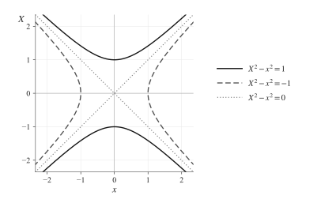
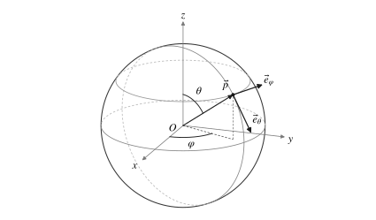
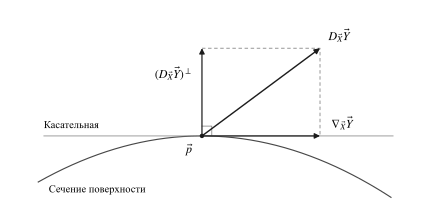
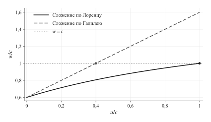

# Псевдоевклидово пространство и локальная симметрия сферы

Дифференциальная геометрия и основы тензорного исчисления. Вариант №9.

[Титульный лист, задание и календарный план](assets/front-matter.pdf)

## Введение

Длина и время зависят от движения наблюдателя. При больших скоростях для перехода между системами отсчёта применяют преобразования Лоренца. Они сохраняют пространственно-временной интервал, который задаётся квадратичной формой с одним положительным и тремя отрицательными слагаемыми. Так псевдоевклидова геометрия возникает в специальной теории относительности.

На кривой поверхности меняется сама формула измерения расстояний. Простой пример — сфера, используемая при описании движения по поверхности Земли. Её геометрия одинакова около любой точки, хотя координатные формулы могут различаться.

Цель работы — получить преобразования, сохраняющие псевдоевклидову форму, установить их связь с СТО, вычислить кривизны сферы и доказать её локальную симметричность. В обоих случаях ищем преобразования, сохраняющие заданную метрику.

## 1. Псевдоевклидово пространство и его изометрии

### 1.1. Билинейная форма и её матрица

Пусть $V$ — вещественное линейное пространство размерности $n$. *Билинейная форма* на $V$ — числовая функция двух векторов, линейная по каждому аргументу:
```math
\begin{aligned}
g&:V\times V\to\mathbb R,\\
g(\alpha\vec{u}+\beta\vec{v},\vec{w})
&=\alpha g(\vec{u},\vec{w})+\beta g(\vec{v},\vec{w}),\\
g(\vec{u},\alpha\vec{v}+\beta\vec{w})
&=\alpha g(\vec{u},\vec{v})+\beta g(\vec{u},\vec{w}),
\end{aligned}
```
где $\vec{u},\vec{v},\vec{w}\in V$, $\alpha,\beta\in\mathbb R$.

Форма называется *симметричной*, если
```math
g(\vec{u},\vec{v})=g(\vec{v},\vec{u}).
```
Форма *невырожденна*, если
```math
\bigl(\forall\vec{v}\in V\quad g(\vec{u},\vec{v})=0\bigr)
\quad\Longrightarrow\quad\vec{u}=\vec{0}.
```
*Далее рассматриваются симметричные невырожденные формы.* Векторы $\vec{u},\vec{v}$ ортогональны, если $g(\vec{u},\vec{v})=0$.

В базисе $\vec{e}_1,\ldots,\vec{e}_n$ разложим оба вектора и применим билинейность.
```math
\vec{u}=\sum_i x^i\vec{e}_i,\qquad \vec{v}=\sum_j y^j\vec{e}_j,
\qquad g(\vec{u},\vec{v})=\sum_i\sum_j x^iy^j g(\vec{e}_i,\vec{e}_j).
```
Обозначим $g_{ij}=g(\vec{e}_i,\vec{e}_j)$. Тогда
```math
\begin{gathered}
G=(g_{ij}),\qquad g_{ij}=g(\vec{e}_i,\vec{e}_j),\\
g(\vec{u},\vec{v})=\sum_{i,j=1}^{n}g_{ij}x^iy^j
=\vec{x}^{\mathsf T}G\vec{y},\\
G^{\mathsf T}=G,\qquad \det G\ne0.
\end{gathered}
```
Здесь $\vec{x}=(x^1,\ldots,x^n)^{\mathsf T}$ и $\vec{y}=(y^1,\ldots,y^n)^{\mathsf T}$ — столбцы координат векторов $\vec{u}$ и $\vec{v}$.

Столбцы матрицы перехода $C$ содержат координаты нового базиса в старом. Тогда
```math
\begin{aligned}
\vec{x}&=C\vec{x}',\qquad \vec{y}=C\vec{y}',\\
g(\vec{u},\vec{v})&=(C\vec{x}')^{\mathsf T}G(C\vec{y}')
=\vec{x}'^{\mathsf T}(C^{\mathsf T}GC)\vec{y}',\\
G'&=C^{\mathsf T}GC.
\end{aligned}
```

### 1.2. Сигнатура формы

Функция $\vec{u}\mapsto g(\vec{u},\vec{u})$ называется *квадратичной формой*, соответствующей $g$. По *закону инерции Сильвестра* можно выбрать базис, в котором она записывается как сумма квадратов с коэффициентами $1$ и $-1$.
```math
\begin{aligned}
G&=J_{p,q}=\operatorname{diag}(E_p,-E_q),\qquad p+q=n,\\
g(\vec{u},\vec{u})&=\sum_{i=1}^{p}(x^i)^2-\sum_{i=p+1}^{n}(x^i)^2.
\end{aligned}
```
Здесь $E_p$ и $E_q$ — единичные матрицы размеров $p$ и $q$. Число положительных квадратов $p$ и отрицательных квадратов $q$ не зависит от выбора базиса. Пара $(p,q)$ называется *сигнатурой формы*.

*Псевдоевклидово пространство* — пара $(V,g)$, где $g$ — симметричная невырожденная билинейная форма. При $q=0$ получаем евклидово пространство. При $p,q>0$ значение $g(\vec{u},\vec{u})$ может быть положительным, отрицательным или нулевым.

Далее рассмотрим плоскость с координатами $(X,x)$ и формой
```math
g\bigl((X,x),(Y,y)\bigr)=XY-xy.
```
Для ненулевого вектора $\vec{u}=(X,x)$ нулевое значение квадратичной формы задаёт две прямые:
```math
g(\vec{u},\vec{u})=0\quad\Longleftrightarrow\quad x=\pm X.
```
Эти прямые существуют и при невырожденной матрице $\operatorname{diag}(1,-1)$. Равенство $g(\vec{u},\vec{u})=0$ означает ортогональность вектора самому себе, а не всем векторам пространства.

На рисунке 1 прямые $x=\pm X$ разделяют области $|X|>|x|$ и $|X|<|x|$. В первой области форма $X^2-x^2$ положительна, во второй отрицательна. Для примера показаны уровни $1$ и $-1$.



Рисунок 1 — Уровни квадратичной формы на псевдоевклидовой плоскости

### 1.3. Условие изометрии

*Линейная изометрия* сохраняет билинейную форму. Для её матрицы $L$:
```math
\begin{aligned}
g(L\vec{u},L\vec{v})&=\vec{x}^{\mathsf T}L^{\mathsf T}GL\vec{y},\\
g(L\vec{u},L\vec{v})=g(\vec{u},\vec{v})
&\Longrightarrow\vec{x}^{\mathsf T}(L^{\mathsf T}GL-G)\vec{y}=0.
\end{aligned}
```
Выбирая $\vec{x}$ и $\vec{y}$ по очереди единичными координатными столбцами, получаем нуль для каждого элемента матрицы в скобках. Поэтому
```math
g(L\vec{u},L\vec{v})=g(\vec{u},\vec{v})
\quad(\forall\vec{u},\vec{v}\in V)
\quad\Longleftrightarrow\quad L^{\mathsf T}GL=G.
```
*Аффинное преобразование* включает линейную часть и перенос. На разность координат двух точек действует только линейная часть:
```math
\begin{aligned}
F(\vec{x})&=L\vec{x}+\vec{d},\\
s^2(P,Q)&=g(\overrightarrow{PQ},\overrightarrow{PQ}),\\
F(\vec{y})-F(\vec{x})&=L(\vec{y}-\vec{x}).
\end{aligned}
```
Перенос сокращается в разности координат. Поэтому достаточно найти линейную часть $L$, сохраняющую форму.

### 1.4. Изометрии псевдоевклидовой плоскости

На плоскости из раздела 1.2 найдём изометрию, переводящую прямую $x=bX$ в ось $x'=0$, где $b\in(-1,1)$. Это условие определяет вид линейного преобразования:
```math
x'=A(x-bX),\qquad X'=BX+Dx,
```
где $A,B,D$ зависят от $b$. Сохранение формы означает
```math
(BX+Dx)^2-A^2(x-bX)^2=X^2-x^2.
```
Сравнивая коэффициенты при $X^2$, $x^2$ и $Xx$, получаем
```math
\begin{aligned}
B^2-A^2b^2&=1,\\
D^2-A^2&=-1,\\
BD+A^2b&=0.
\end{aligned}
```
Из первого равенства $B\ne0$. Подставим $D=-A^2b/B$ во второе:
```math
\begin{aligned}
\frac{A^4b^2}{B^2}-A^2&=-1,\\
A^2(B^2-A^2b^2)&=B^2,\\
B^2-A^2b^2=1&\quad\Longrightarrow\quad A^2=B^2\ne0.
\end{aligned}
```
Выберем преобразования, непрерывно зависящие от $b$ и тождественные при $b=0$. Из $A(0)=B(0)=1$ и отсутствия нулей у $A,B$ следует положительность обоих коэффициентов. Поэтому
```math
A=B>0,\qquad D=-Ab,\qquad A^2(1-b^2)=1,\qquad
A=B=\frac{1}{\sqrt{1-b^2}}.
```
Искомая изометрия имеет вид
```math
\begin{aligned}
X'&=\frac{X-bx}{\sqrt{1-b^2}},\\
x'&=\frac{x-bX}{\sqrt{1-b^2}}.
\end{aligned}
```
Проверка сохранения формы:
```math
X'^2-x'^2=\frac{(X-bx)^2-(x-bX)^2}{1-b^2}=X^2-x^2.
```
Каждая прямая, на которой квадратичная форма обращается в нуль, сохраняется:
```math
x=X\ \Longrightarrow\ x'=X',\qquad
x=-X\ \Longrightarrow\ x'=-X'.
```
Обратное преобразование получается заменой $b$ на $-b$.

Для более удобной записи преобразования используем гиперболические функции:
```math
\cosh\psi=\frac{e^\psi+e^{-\psi}}2,\qquad
\sinh\psi=\frac{e^\psi-e^{-\psi}}2,\qquad
\tanh\psi=\frac{\sinh\psi}{\cosh\psi}.
```
Для каждого $b\in(-1,1)$ существует единственный $\psi\in\mathbb R$, для которого
```math
b=\tanh\psi,\qquad
\frac1{\sqrt{1-b^2}}=\cosh\psi,\qquad
\frac b{\sqrt{1-b^2}}=\sinh\psi.
```
В координатах $(X,x)$ получаем матричную запись
```math
\begin{pmatrix}X'\\x'\end{pmatrix}
=\Lambda(\psi)\begin{pmatrix}X\\x\end{pmatrix},\qquad
\Lambda(\psi)=
\begin{pmatrix}
\cosh\psi&-\sinh\psi\\
-\sinh\psi&\cosh\psi
\end{pmatrix}.
```
Это *гиперболический поворот*, сохраняющий $X^2-x^2$. Такая запись удобна при последовательном выполнении преобразований: параметры $\psi$ складываются. Например, первый элемент произведения равен
```math
\cosh\psi_2\cosh\psi_1+\sinh\psi_2\sinh\psi_1
=\cosh(\psi_1+\psi_2).
```
Остальные элементы вычисляются так же:
```math
\Lambda(\psi_2)\Lambda(\psi_1)=\Lambda(\psi_1+\psi_2),\qquad
\Lambda(\psi)^{-1}=\Lambda(-\psi).
```
Подставляя $(X,x)=(1,0)$ в преобразование и меняя $\psi$, получаем точки одной ветви гиперболы:
```math
(X',x')=(\cosh\psi,-\sinh\psi),\qquad X'^2-x'^2=1,\qquad X'>0.
```

На рисунке 2 сравниваем обычный и гиперболический повороты. В правой части по горизонтали отложено $x$, по вертикали — $X$ (в СТО $X=ct$).


Рисунок 2 — Обычный и гиперболический повороты

## 2. Геометрия и локальная симметрия сферы

### 2.1. Метрика сферы

Проведём расчёт для радиуса $a>0$, затем положим $a=1$. Сферу задаём уравнением
```math
S_a^2=\{\vec p\in\mathbb R^3:\langle\vec p,\vec p\rangle=a^2\}.
```
Найдём касательную плоскость в точке $\vec p$. Для кривой $\vec r(t)$ на сфере, где $\vec r(0)=\vec p$, дифференцируем уравнение сферы.
```math
\langle\vec r(t),\vec r(t)\rangle=a^2
\quad\Longrightarrow\quad 2\langle\vec p,\vec r'(0)\rangle=0.
```
Все касательные векторы перпендикулярны $\vec p$. Обе плоскости двумерны, поэтому
```math
T_{\vec p}S_a^2=\{\vec v:\langle\vec p,\vec v\rangle=0\}=\vec p^{\perp}.
```
Обычная метрика сферы — евклидово скалярное произведение касательных векторов.
```math
g_{\vec p}(\vec v,\vec w)=\langle\vec v,\vec w\rangle,\qquad
g_{\vec p}(\vec v,\vec v)=\|\vec v\|^2>0\quad(\vec v\ne\vec0).
```
В сферических координатах $x^1=\theta$, $x^2=\varphi$ возьмём параметризацию
```math
\begin{gathered}
\vec{r}(\theta,\varphi)=a(\sin\theta\cos\varphi,\sin\theta\sin\varphi,\cos\theta),\\
0<\theta<\pi,\qquad \alpha<\varphi<\alpha+2\pi.
\end{gathered}
```
Углы $\theta,\varphi$ показаны на рисунке 3. В этой системе координат исключены полюса и начальный меридиан. Векторы $\vec e_\theta,\vec e_\varphi$ направлены по росту соответствующих углов.



Рисунок 3 — Сферические координаты и касательные векторы

Найдём векторы $\vec e_\theta=\partial_\theta\vec r$ и $\vec e_\varphi=\partial_\varphi\vec r$.
```math
\begin{aligned}
\vec{r}_\theta&=a(\cos\theta\cos\varphi,\cos\theta\sin\varphi,-\sin\theta),\\
\vec{r}_\varphi&=a(-\sin\theta\sin\varphi,\sin\theta\cos\varphi,0).
\end{aligned}
```
Раскроем квадрат длины малого перемещения по сфере.
```math
\begin{aligned}
d\vec r&=\vec e_\theta\,d\theta+\vec e_\varphi\,d\varphi,\\
ds^2&=\langle d\vec r,d\vec r\rangle
=g_{\theta\theta}d\theta^2+2g_{\theta\varphi}d\theta\,d\varphi
+g_{\varphi\varphi}d\varphi^2.
\end{aligned}
```
По определению $g_{ij}=\langle\vec e_i,\vec e_j\rangle$. Подставим найденные производные.
```math
\begin{aligned}
g_{\theta\theta}
&=a^2\bigl(\cos^2\theta(\cos^2\varphi+\sin^2\varphi)+\sin^2\theta\bigr)=a^2,\\
g_{\theta\varphi}
&=a^2\cos\theta\sin\theta(-\cos\varphi\sin\varphi+\sin\varphi\cos\varphi)=0,\\
g_{\varphi\varphi}
&=a^2\sin^2\theta(\sin^2\varphi+\cos^2\varphi)=a^2\sin^2\theta.
\end{aligned}
```
Следовательно,
```math
G=\operatorname{diag}(a^2,a^2\sin^2\theta),\qquad
ds^2=a^2(d\theta^2+\sin^2\theta\,d\varphi^2),
```
```math
\det G=a^4\sin^2\theta>0,\qquad
G^{-1}=\operatorname{diag}\left(a^{-2},(a^2\sin^2\theta)^{-1}\right).
```
В выбранной области матрица метрики невырожденна.

### 2.2. Ковариантная производная и символы Кристоффеля

Для вычисления кривизны нужны производные касательных векторов. Берём касательную часть обычной производной $D_{\vec X}\vec Y$ и обозначаем её $\nabla_{\vec X}\vec Y$ — *ковариантная производная* (рисунок 4).



Рисунок 4 — Касательная проекция обычной производной

Положим $\partial_i=\partial/\partial x^i$, $\vec e_i=\partial_i\vec r$, где $x^1=\theta$, $x^2=\varphi$. По повторяющимся верхнему и нижнему индексам суммируем от 1 до 2. Разложим касательную производную по базису.
```math
\nabla_{\vec{e}_i}\vec{e}_j=\Gamma^k{}_{ij}\vec{e}_k.
```
Для $\vec{Y}=Y^k\vec{e}_k$ применим правило произведения:
```math
\begin{aligned}
\nabla_{\vec{e}_i}\vec{Y}
&=(\partial_iY^k)\vec{e}_k+Y^j\nabla_{\vec{e}_i}\vec{e}_j\\
&=(\partial_iY^k+\Gamma^k{}_{ij}Y^j)\vec{e}_k.
\end{aligned}
```
В направлении $\vec{X}=X^i\vec{e}_i$ *ковариантная производная* равна
```math
\nabla_{\vec{X}}\vec{Y}
=X^i\left(\partial_iY^k+\Gamma^k{}_{ij}Y^j\right)\vec{e}_k,
\qquad \vec{X}=X^i\vec{e}_i,\quad \vec{Y}=Y^j\vec{e}_j.
```
Коэффициенты $\Gamma^k{}_{ij}$ — *символы Кристоффеля*. Для их вычисления используем равенство смешанных производных $\vec r$.
```math
\partial_i\vec e_j=\partial_i\partial_j\vec r=\partial_j\vec e_i
\quad\Longrightarrow\quad \Gamma^k{}_{ij}=\Gamma^k{}_{ji}.
```
Дифференцируем $g_{j\ell}=\langle\vec e_j,\vec e_\ell\rangle$. Нормальные части производных ортогональны $\vec e_j,\vec e_\ell$, поэтому в скалярных произведениях остаются только касательные части.
```math
\begin{aligned}
\partial_i g_{j\ell}&=\Gamma^m{}_{ij}g_{m\ell}+\Gamma^m{}_{i\ell}g_{jm},\\
\partial_j g_{i\ell}&=\Gamma^m{}_{ji}g_{m\ell}+\Gamma^m{}_{j\ell}g_{im},\\
\partial_\ell g_{ij}&=\Gamma^m{}_{\ell i}g_{mj}+\Gamma^m{}_{\ell j}g_{im}.
\end{aligned}
```
Сложим первые два равенства и вычтем третье. При $\Gamma^m{}_{ij}=\Gamma^m{}_{ji}$ попарно сокращаются четыре слагаемых:
```math
\partial_i g_{j\ell}+\partial_j g_{i\ell}-\partial_\ell g_{ij}
=2\Gamma^m{}_{ij}g_{m\ell}.
```
Пусть $(g^{ij})=G^{-1}$, а $\delta^k{}_m$ равна 1 при $k=m$ и 0 иначе. Умножим равенство на $g^{k\ell}$ и просуммируем по $\ell$. Из $g^{k\ell}g_{m\ell}=\delta^k{}_m$ получаем
```math
\Gamma^k{}_{ij}=\frac12g^{k\ell}
\left(\partial_i g_{j\ell}+\partial_j g_{i\ell}-\partial_\ell g_{ij}\right).
```
От координат зависит только коэффициент $g_{\varphi\varphi}$. Его производная равна
```math
\partial_\theta g_{\varphi\varphi}=2a^2\sin\theta\cos\theta.
```
Подстановка в формулу символов Кристоффеля даёт
```math
\begin{aligned}
\Gamma^\theta{}_{\varphi\varphi}
&=-\frac12g^{\theta\theta}\partial_\theta g_{\varphi\varphi}
=-\frac1{2a^2}\,2a^2\sin\theta\cos\theta
=-\sin\theta\cos\theta,\\
\Gamma^\varphi{}_{\theta\varphi}
&=\frac12g^{\varphi\varphi}\partial_\theta g_{\varphi\varphi}
=\frac{2a^2\sin\theta\cos\theta}{2a^2\sin^2\theta}
=\cot\theta.
\end{aligned}
```
Учитывая симметрию нижних индексов, имеем также $\Gamma^\varphi{}_{\varphi\theta}=\cot\theta$. Остальные коэффициенты нулевые.

### 2.3. Тензор кривизны и кривизны сферы

В координатном базисе $\vec e_i=\partial_i\vec r$ смешанные производные совпадают. Кривизну вычисляем по разности двух порядков ковариантного дифференцирования.
```math
R(\vec e_i,\vec e_j)\vec e_k
=\nabla_{\vec e_i}\nabla_{\vec e_j}\vec e_k
-\nabla_{\vec e_j}\nabla_{\vec e_i}\vec e_k
=R^l{}_{kij}\vec e_l.
```
Применим определение к базисным векторам. Сначала
```math
\begin{aligned}
\nabla_{\vec{e}_i}\nabla_{\vec{e}_j}\vec{e}_k
&=\nabla_{\vec{e}_i}(\Gamma^m{}_{jk}\vec{e}_m)\\
&=\left(\partial_i\Gamma^l{}_{jk}
+\Gamma^m{}_{jk}\Gamma^l{}_{im}\right)\vec{e}_l.
\end{aligned}
```
Вычтем такое же выражение с переставленными $i,j$. Получаем
```math
R^l{}_{kij}=\partial_i\Gamma^l{}_{jk}-\partial_j\Gamma^l{}_{ik}
+\Gamma^m{}_{jk}\Gamma^l{}_{im}-\Gamma^m{}_{ik}\Gamma^l{}_{jm}.
```
При перестановке $i,j$ компоненты меняют знак. Подставим найденные символы Кристоффеля. Для первой компоненты раскроем сумму по $m$.
```math
\begin{aligned}
R^\theta{}_{\varphi\theta\varphi}
&=\partial_\theta\Gamma^\theta{}_{\varphi\varphi}
-\partial_\varphi\Gamma^\theta{}_{\theta\varphi}\\
&\quad+\Gamma^\theta{}_{\varphi\varphi}\Gamma^\theta{}_{\theta\theta}
+\Gamma^\varphi{}_{\varphi\varphi}\Gamma^\theta{}_{\theta\varphi}\\
&\quad-\Gamma^\theta{}_{\theta\varphi}\Gamma^\theta{}_{\varphi\theta}
-\Gamma^\varphi{}_{\theta\varphi}\Gamma^\theta{}_{\varphi\varphi}.
\end{aligned}
```
Второе слагаемое с производной и первые три произведения равны нулю. Поэтому

```math
\begin{aligned}
R^\theta{}_{\varphi\theta\varphi}
&=\partial_\theta\Gamma^\theta{}_{\varphi\varphi}
-\Gamma^\varphi{}_{\theta\varphi}\Gamma^\theta{}_{\varphi\varphi}\\
&=\partial_\theta(-\sin\theta\cos\theta)
-\cot\theta(-\sin\theta\cos\theta)\\
&=\sin^2\theta-\cos^2\theta+\cos^2\theta=\sin^2\theta,\\[2mm]
R^\varphi{}_{\theta\varphi\theta}
&=-\partial_\theta\Gamma^\varphi{}_{\theta\varphi}
-(\Gamma^\varphi{}_{\theta\varphi})^2\\
&=-\partial_\theta(\cot\theta)-\cot^2\theta
=\frac1{\sin^2\theta}-\frac{\cos^2\theta}{\sin^2\theta}=1.
\end{aligned}
```
Оставшиеся компоненты при $(i,j)=(\theta,\varphi)$:
```math
R^\theta{}_{\theta\theta\varphi}=0,\qquad
R^\varphi{}_{\varphi\theta\varphi}=-\partial_\varphi(\cot\theta)=0.
```
При $i=j$ компоненты равны нулю; при перестановке $i,j$ меняют знак. Следовательно, найдены все компоненты тензора. В частности,
```math
\begin{aligned}
R(\vec{e}_\theta,\vec{e}_\varphi)\vec{e}_\theta
&=-\vec{e}_\varphi,\\
R(\vec{e}_\theta,\vec{e}_\varphi)\vec{e}_\varphi
&=\sin^2\theta\,\vec{e}_\theta.
\end{aligned}
```
По определению гауссовой кривизны для базиса $\vec e_\theta,\vec e_\varphi$
```math
\begin{aligned}
K&=\frac{g(R(\vec e_\theta,\vec e_\varphi)\vec e_\varphi,\vec e_\theta)}
{g_{\theta\theta}g_{\varphi\varphi}-g_{\theta\varphi}^2}\\
&=\frac{g(\sin^2\theta\,\vec e_\theta,\vec e_\theta)}
{a^4\sin^2\theta}
=\frac{a^2\sin^2\theta}{a^4\sin^2\theta}
=\frac1{a^2}.
\end{aligned}
```
Найдём тензор Риччи суммированием по одному индексу.
```math
\operatorname{Ric}_{kj}=\sum_i R^i{}_{kij}.
```
Подставим вычисленные компоненты.
```math
\begin{aligned}
\operatorname{Ric}_{\theta\theta}&=R^\theta{}_{\theta\theta\theta}+R^\varphi{}_{\theta\varphi\theta}=0+1=1,\\
\operatorname{Ric}_{\varphi\varphi}&=R^\theta{}_{\varphi\theta\varphi}+R^\varphi{}_{\varphi\varphi\varphi}=\sin^2\theta+0,\\
\operatorname{Ric}_{\theta\varphi}&=\operatorname{Ric}_{\varphi\theta}=0.
\end{aligned}
```
Следовательно,
```math
(\operatorname{Ric}_{ij})=\operatorname{diag}(1,\sin^2\theta),
\qquad \operatorname{Ric}=\frac1{a^2}g.
```
Подставляем компоненты обратной матрицы метрики и тензора Риччи в определение скалярной кривизны:
```math
\operatorname{Scal}
=g^{\theta\theta}\operatorname{Ric}_{\theta\theta}
+g^{\varphi\varphi}\operatorname{Ric}_{\varphi\varphi}
=\frac1{a^2}+\frac{\sin^2\theta}{a^2\sin^2\theta}
=\frac2{a^2}=2K.
```

Полученный расчёт выполнен вне полюсов $\theta=0,\pi$ и выбранного меридиана. Чтобы охватить остальные точки, выберем другую полярную ось и другой начальный меридиан. Поворот $Q$ сохраняет евклидово скалярное произведение:
```math
Q^{\mathsf T}Q=E_3,\qquad
\widetilde{\vec{r}}=Q\vec{r},\qquad
\langle Q\vec{r}_{x^i},Q\vec{r}_{x^j}\rangle
=\langle\vec{r}_{x^i},\vec{r}_{x^j}\rangle.
```
В новых сферических координатах метрика имеет тот же вид, поэтому расчёт повторяется без изменений. Так можно охватить любую точку $S_a^2$, включая полюса исходной параметризации.

### 2.4. Геодезические и симметрия сферы

Для доказательства симметрии найдём *геодезические* сферы. Их касательное ускорение равно нулю.
```math
\nabla_{\dot{\vec{\gamma}}}\dot{\vec{\gamma}}=\vec{0}.
```
Найдём такую кривую на сфере по её начальной точке и скорости.

Чтобы доказать локальную симметричность, построим в каждой точке $\vec p$ обратимое гладкое преобразование $s_{\vec p}$. Оно должно сохранять метрику и обращать направление геодезических через $\vec p$.
```math
\begin{aligned}
g_{s_{\vec p}(\vec q)}\bigl((ds_{\vec p})_{\vec q}\vec v,(ds_{\vec p})_{\vec q}\vec w\bigr)
&=g_{\vec q}(\vec v,\vec w),\\
s_{\vec p}(\vec\gamma(t))&=\vec\gamma(-t),\qquad \vec\gamma(0)=\vec p.
\end{aligned}
```
В первом равенстве $\vec v,\vec w$ касательны в точке $\vec q$, а $(ds_{\vec p})_{\vec q}$ — производная преобразования в этой точке. Сохранение метрики проверим во всех точках сферы.

Построим симметрию сферы в произвольной точке $\vec p\in S_a^2$. Разложим радиус-вектор $\vec q$ на составляющие вдоль $\vec p$ и перпендикулярно ему.
```math
\vec{q}=\lambda\vec{p}+\vec{v},\qquad \lambda=\frac{\langle\vec{p},\vec{q}\rangle}{a^2},\qquad
\langle\vec{p},\vec{v}\rangle=0.
```

Сохраним составляющую вдоль оси $\mathbb R\vec p$ и поменяем знак перпендикулярной. Получим поворот на $\pi$ вокруг этой оси.
```math
s_{\vec p}(\vec q)=\lambda\vec p-\vec v
=2\lambda\vec p-\vec q
=2\frac{\langle\vec p,\vec q\rangle}{a^2}\vec p-\vec q.
```
Чтобы проверить сохранение скалярного произведения, так же разложим второй вектор $\vec w=\mu\vec p+\vec z$, где $\vec z\perp\vec p$.
```math
\begin{aligned}
\langle s_{\vec{p}}(\vec{q}),s_{\vec{p}}(\vec{w})\rangle
&=\langle\lambda\vec{p}-\vec{v},\mu\vec{p}-\vec{z}\rangle\\
&=\lambda\mu a^2+\langle\vec{v},\vec{z}\rangle
=\langle\vec{q},\vec{w}\rangle.
\end{aligned}
```
В частности, длины сохраняются, сфера переходит в себя. Преобразование линейно, поэтому его дифференциал действует той же формулой и сохраняет метрику касательных плоскостей. Кроме того,
```math
s_{\vec{p}}^2=\operatorname{Id},\qquad s_{\vec{p}}(\vec{p})=\vec{p},\qquad
(ds_{\vec{p}})_{\vec{p}}\vec{v}=-\vec{v}\quad(\vec{v}\perp\vec{p}).
```
Остаётся проверить, что $s_{\vec p}$ заменяет $t$ на $-t$ вдоль геодезической. Для этого найдём её уравнение через обычную вторую производную. Из раздела 2.2 касательная часть $\vec r_{ij}=\partial_i\vec e_j$ равна $\Gamma^k{}_{ij}\vec e_k$. Поэтому для кривой $\vec{\gamma}(t)=\vec{r}(x^1(t),x^2(t))$ получаем
```math
\begin{aligned}
\ddot{\vec{\gamma}}&=\vec{r}_k\ddot x^k+\vec{r}_{ij}\dot x^i\dot x^j,\\
(\ddot{\vec{\gamma}})_{\mathrm{кас}}
&=(\ddot x^k+\Gamma^k{}_{ij}\dot x^i\dot x^j)\vec{e}_k
=\nabla_{\dot{\vec{\gamma}}}\dot{\vec{\gamma}}.
\end{aligned}
```
Таким образом, ускорение геодезической на сфере направлено по радиусу: $\ddot{\vec{\gamma}}=f(t)\vec{\gamma}$. Дифференцируем $|\vec{\gamma}|^2=a^2$:
```math
\langle\vec{\gamma},\dot{\vec{\gamma}}\rangle=0,\qquad
|\dot{\vec{\gamma}}|^2+\langle\vec{\gamma},\ddot{\vec{\gamma}}\rangle=0.
```
Модуль скорости постоянен, поскольку
```math
\frac{d}{dt}|\dot{\vec{\gamma}}|^2
=2\langle\dot{\vec{\gamma}},\ddot{\vec{\gamma}}\rangle
=2f(t)\langle\dot{\vec{\gamma}},\vec{\gamma}\rangle=0.
```
При начальных данных $\vec{\gamma}(0)=\vec{p}$, $\dot{\vec{\gamma}}(0)=\vec{v}\in T_{\vec p}S_a^2$ получаем
```math
\ddot{\vec{\gamma}}=-\frac{|\vec{v}|^2}{a^2}\vec{\gamma},\qquad
\vec{\gamma}(t)=\vec{p}\cos kt+\frac{\vec{v}}k\sin kt,\qquad k=\frac{|\vec{v}|}a.
```
Формула записана для $\vec{v}\ne0$; при $\vec{v}=0$ кривая постоянна. Для ненулевой скорости проверяем
```math
\begin{aligned}
|\vec{\gamma}(t)|^2&=a^2\cos^2kt+\frac{|\vec{v}|^2}{k^2}\sin^2kt=a^2,\\
s_{\vec{p}}(\vec{\gamma}(t))
&=\vec{p}\cos kt-\frac{\vec{v}}k\sin kt
=\vec{\gamma}(-t).
\end{aligned}
```
Построенное преобразование сохраняет метрику и меняет направление геодезических через $\vec p$. Точка произвольна, поэтому сфера локально симметрична.

На рисунке 5 в сечении через ось поворота показаны точка $\vec{q}$ и её образ. Соответствующие дуги выходят из $\vec{p}$ в противоположных направлениях и имеют одинаковую длину.


Рисунок 5 — Геодезическая симметрия сферы

*Итог для единичной сферы.* При $a=1$ получаем
```math
K=1,\qquad \operatorname{Scal}=2.
```
Стандартная сфера $S^2$ с обычной метрикой локально симметрична.

## 3. Применение псевдоевклидовой геометрии в СТО

### 3.1. Пространство Минковского и интервал

Применим результат раздела 1 к инерциальным системам отсчёта. Свободное тело в них движется равномерно и прямолинейно.

Переход строим из постоянства скорости света, равноправия инерциальных систем и направлений пространства. Однородность пространства и времени означает, что одинаковые приращения координат дают одинаковые приращения новых координат.
```math
F(\vec a+\vec b)-F(\vec a)=F(\vec b)-F(\vec 0).
```
Здесь $F$ — преобразование координат, $\vec a,\vec b$ — столбцы четырёх координат. При $F(\vec0)=\vec0$ оно сохраняет суммы. По непрерывности получаем линейное преобразование $F(\vec a)=L\vec a$.

*Событие* задаётся местом и временем $t$. Время выбранной системы отсчёта называют координатным. Для совместной записи пространственных и временной координат положим
```math
\begin{aligned}
x^0&=ct,\qquad x^1=x,\\
x^2&=y,\qquad x^3=z.
\end{aligned}
```
В этих координатах введём форму сигнатуры $(1,3)$. В следующем разделе проверим, что переход между системами её сохраняет. Соответствующее пространство называется *пространством Минковского*. Для векторов $\vec A,\vec B$ с компонентами $A^\mu,B^\mu$, где $\mu=0,1,2,3$, имеем
```math
\begin{aligned}
\eta&=\operatorname{diag}(1,-1,-1,-1),\\
\eta(\vec{A},\vec{B})&=A^0B^0-A^1B^1-A^2B^2-A^3B^3.
\end{aligned}
```
Положим $\vec{r}=(x,y,z)$. Квадрат интервала между событиями — значение формы на разности их координат:
```math
\begin{aligned}
\Delta s^2&=c^2(\Delta t)^2-|\Delta\vec{r}|^2,\\
ds^2&=c^2dt^2-dx^2-dy^2-dz^2.
\end{aligned}
```
По знаку $\Delta s^2$ различаем три случая.
```math
\begin{aligned}
\Delta s^2>0&:\quad\text{времениподобный вектор},\\
\Delta s^2=0&:\quad\text{светоподобный вектор},\\
\Delta s^2<0&:\quad\text{пространственноподобный вектор}.
\end{aligned}
```
Нулевое значение квадратичной формы определяет световой конус:
```math
|\Delta\vec{r}|=c|\Delta t|.
```

### 3.2. Вывод преобразований Лоренца

Пусть система $K'$ движется относительно $K$ вдоль оси $x$ со скоростью $v$. Здесь $v$ — проекция скорости на эту ось; она может иметь любой знак. Оси сонаправлены, начала совпадают при $t=t'=0$. Обозначим
```math
X=ct,\qquad \beta=v/c,\qquad |\beta|<1.
```
Сначала отделим координаты вдоль движения от поперечных. Поворот на $180^\circ$ вокруг оси $x$ меняет знаки $y,z$, но не меняет $X,x$ и условия движения. Поэтому в линейные выражения для $X',x'$ не входят $y,z$, а в $y',z'$ — $X,x$. Поперечные оси сонаправлены; поворота между ними нет. По равноправию этих направлений $y'=s(v)y,\ z'=s(v)z$, где $s(v)>0$.

Для света вдоль оси $x$ равенства $X=x$ и $X=-x$ должны выполняться и в новой системе. Поэтому $X'+x'$ пропорционально $X+x$, а $X'-x'$ — $X-x$. При $v=0$ коэффициенты равны 1; выбираем непрерывно зависящие от $v$ положительные коэффициенты:
```math
\begin{aligned}
X'+x'&=a_+(v)(X+x),\\
X'-x'&=a_-(v)(X-x),\qquad a_+(v),a_-(v)>0,\\
X'^2-x'^2&=k(v)(X^2-x^2),\qquad k(v)=a_+(v)a_-(v)>0.
\end{aligned}
```
Сложим и вычтем первые два равенства.
```math
A=\frac{a_++a_-}{2},\quad B=\frac{a_+-a_-}{2},\qquad
X'=AX+Bx,\quad x'=BX+Ax.
```
Для начала $K'$ подставим $x=\beta X$, $x'=0$.
```math
0=BX+A\beta X\quad\Longrightarrow\quad B=-\beta A.
```
Для начала $K$ подставим $x=0$.
```math
\frac{x'}{X'}=\frac BA=-\beta.
```
Поэтому обратному переходу соответствует скорость $-v$.

При повороте осей на $180^\circ$ вокруг $y$ скорость меняет знак, а выражения $X^2-x^2$ и $X'^2-x'^2$ не меняются. Поэтому $k(-v)=k(v)$. Прямой и обратный переходы дают
```math
k(-v)=k(v),\qquad k(-v)k(v)=1
\quad\Longrightarrow\quad k(v)^2=1\quad\Longrightarrow\quad k(v)=1.
```
Для луча вдоль оси $y$ имеем $X=y$, $x=z=0$. В системе $K'$ постоянство скорости света даёт $X'^2-x'^2=y'^2=s(v)^2y^2$. Из $k(v)=1$ левая часть равна $y^2$. Значит, $s(v)=1$ и $y'=y$, $z'=z$.

Начало $K'$ движется по прямой $x=\beta X$, переходящей в $x'=0$. Следовательно, применимо найденное в §1.4 преобразование. Подставляя $b=\beta$ и деля $X'$ на $c$, получаем
```math
\begin{gathered}
x'=\gamma(x-vt),\qquad t'=\gamma\left(t-\frac{vx}{c^2}\right),\\
y'=y,\qquad z'=z,\qquad \gamma=\frac1{\sqrt{1-v^2/c^2}}.
\end{gathered}
```
Это *преобразования Лоренца*; $\gamma$ — *коэффициент Лоренца*. Сохранение $X^2-x^2$ вместе с $y'=y$, $z'=z$ означает сохранение полного интервала. Пусть $\Lambda$ — матрица полного преобразования $(ct,x,y,z)$. По координатам $(ct,x)$ действует матрица из §1.4, а координаты $y,z$ не меняются. Тогда
```math
\Lambda^{\mathsf T}\eta\Lambda=\eta.
```
Обратное преобразование получается заменой $v$ на $-v$.

При $v=0{,}6c$ в сечении $y=z=0$, $ct\ge0$ оси системы $K'$ определяются равенствами
```math
x'=0:\quad x=\beta ct,\qquad
t'=0:\quad ct=\beta x.
```
Гипербола объединяет события с одинаковым квадратом интервала от начала координат:
```math
c^2t^2-x^2=1.
```
На рисунке 6 отмечена точка $P$ на этой гиперболе. Её координаты в условных единицах
```math
(x,ct)=(3/4,5/4),\qquad (x',ct')=(0,1),\qquad s^2=1.
```


Рисунок 6 — Диаграмма Минковского

Параметр $\psi$, введённый в разделе 1.4, в СТО называется быстротой. Он связан со скоростью равенствами
```math
\beta=\tanh\psi,\qquad \gamma=\cosh\psi,\qquad \gamma\beta=\sinh\psi.
```
На рисунках 2 и 6 гипербола показывает точки с одним и тем же квадратом интервала от начала координат. Само пространство Минковского плоское, поскольку матрица $\eta$ постоянна.
```math
\partial_\rho\eta_{\mu\nu}=0\quad\Longrightarrow\quad
\Gamma^\lambda{}_{\mu\nu}=0\quad\Longrightarrow\quad R=0.
```
Формулы для символов Кристоффеля и кривизны из главы 2 применимы и здесь: для них достаточно невырожденности метрики.

Пусть $K_1$ движется относительно $K$ со скоростью $v_1$, а $K_2$ относительно $K_1$ — со скоростью $v_2$ вдоль той же оси. Положим $\beta_i=v_i/c$ и определим быстроты $\psi_i$ из $\tanh\psi_i=\beta_i$. Складывая параметры гиперболических поворотов, получаем
```math
\begin{aligned}
\tanh(\psi_1+\psi_2)&=\frac{\beta_1+\beta_2}{1+\beta_1\beta_2},\\
v&=\frac{v_1+v_2}{1+v_1v_2/c^2}.
\end{aligned}
```
Это скорость, полученная после двух последовательных переходов между системами. Проверим ограничение скорости:
```math
1-\frac{v^2}{c^2}
=\frac{(1-\beta_1^2)(1-\beta_2^2)}{(1+\beta_1\beta_2)^2}>0.
\qquad |v|<c.
```

### 3.3. Собственное время и измерение длины

*Мировая линия* — кривая, образованная событиями движения тела. Вдоль неё часы, движущиеся вместе с телом, измеряют *собственное время* $\tau$. Рассмотрим движение с $dt>0$ и скоростью
```math
\vec{u}=\frac{d\vec{r}}{dt},\qquad |\vec{u}|<c.
```
В системе мгновенного покоя часов $d\vec r'=0$, поэтому $ds^2=c^2d\tau^2$. В исходной системе подставляем $d\vec r=\vec u\,dt$:
```math
ds^2=c^2dt^2\left(1-\frac{|\vec{u}|^2}{c^2}\right)=c^2d\tau^2.
```
При $dt>0$ берём положительный корень и интегрируем от $t_1$ до $t_2$.
```math
\begin{aligned}
d\tau&=dt\sqrt{1-\frac{|\vec{u}|^2}{c^2}},\\
\tau_2-\tau_1&=\int_{t_1}^{t_2}\sqrt{1-\frac{|\vec{u}(t)|^2}{c^2}}\,dt.
\end{aligned}
```
Здесь $\Delta\tau$ — промежуток по движущимся часам, а $\Delta t$ — разность координатного времени тех же событий. Собственное время зависит от выбранной мировой линии, но не от системы отсчёта. При постоянном модуле скорости интеграл даёт
```math
\Delta t=\gamma_u\Delta\tau,\qquad
\gamma_u=\frac1{\sqrt{1-|\vec{u}|^2/c^2}}.
```
При ненулевой скорости промежуток собственного времени меньше разности координатного времени тех же событий. Это соотношение называют замедлением времени.

Пусть световые часы покоятся в $K'$, а зеркала разделены расстоянием $h$ поперёк движения. Полный цикл длится $\Delta\tau$ в $K'$ и $\Delta t$ в $K$. При движении вдоль $x$ высота сохраняется ($y'=y$). Для половины цикла
```math
\left(\frac{c\Delta t}{2}\right)^2=h^2+\left(\frac{v\Delta t}{2}\right)^2,
\qquad \Delta\tau=\frac{2h}{c}.
```
Решая полученное уравнение относительно длительности цикла, находим
```math
\frac{(c^2-v^2)\Delta t^2}{4}=h^2,
\qquad\Delta t=\frac{2h}{c\sqrt{1-v^2/c^2}}=\gamma\Delta\tau.
```
В системе $K$ свет проходит больший путь с той же скоростью $c$, поэтому цикл длится дольше. При $v=0{,}6c$ и $\Delta\tau=1$ нс получаем
```math
\Delta t=\gamma\Delta\tau=1{,}25\ \text{нс}.
```
Схема дана в плоскости $xy$; положения зеркал справа относятся к разным моментам прохождения света.

На рисунке 7 события $A,B,C$ — испускание, отражение и возвращение света. В системе покоя часов события $A$ и $C$ происходят у одного зеркала.


Рисунок 7 — Световые часы в двух инерциальных системах

Для измерения длины стержня положения его концов необходимо зарегистрировать одновременно в выбранной системе. По преобразованию времени
```math
\Delta t=0\quad\Longrightarrow\quad
\Delta t'=-\gamma\frac{v\Delta x}{c^2}.
```
При $v\Delta x\ne0$ одновременность в $K$ не означает одновременности в $K'$. Пусть стержень покоится в $K'$ вдоль $x'$ и имеет собственную длину $L_0$. В системе $K$ положим $\Delta t=0$, $\Delta x=L$. Поскольку концы неподвижны в $K'$, для выбранной пары событий $\Delta x'=L_0$. Тогда
```math
L_0=\Delta x'=\gamma(\Delta x-v\Delta t)=\gamma L,
\qquad L=\frac{L_0}{\gamma}.
```
При $L_0=1$ м, $v=0{,}6c$ имеем
```math
L=\frac{L_0}{\gamma}=0{,}8\ \text{м}.
```
Различие длин связано с выбором событий: одновременная регистрация концов стержня в каждой системе даёт свою пару событий.

На рисунке 8 пара $A,B$ соответствует одному $t$, а $A,C$ — одному $t'$ (прямая $t'=0$).


Рисунок 8 — Измерение длины движущегося стержня

### 3.4. Преобразование скоростей

Для скорости частицы $\vec{u}=(u_x,u_y,u_z)$ сначала дифференцируем координаты:
```math
\begin{aligned}
dx'&=\gamma(dx-v\,dt),\qquad dy'=dy,\qquad dz'=dz,\\
dt'&=\gamma\left(dt-\frac{v}{c^2}dx\right).
\end{aligned}
```
Подставим $dx=u_xdt$:
```math
dt'=\gamma\left(1-\frac{vu_x}{c^2}\right)dt.
```
Деление пространственных дифференциалов на $dt'$ приводит к формулам
```math
u_x'=\frac{u_x-v}{1-vu_x/c^2},\qquad
u_y'=\frac{u_y}{\gamma(1-vu_x/c^2)},\qquad
u_z'=\frac{u_z}{\gamma(1-vu_x/c^2)}.
```
При $|\vec{u}|<c$, $|v|<c$ имеем $dt'/dt>0$. Из равенства квадратов интервала
```math
\bigl(c^2-|\vec u'|^2\bigr)dt'^2=\bigl(c^2-|\vec u|^2\bigr)dt^2
```
следует $|\vec u'|<c$. Для $\vec{u}=(v,0,0)$ частица покоится в $K'$, а для луча $u_x=c$ имеем $u_x'=c$. При $u_x=0{,}8c$, $v=0{,}6c$, $u_y=u_z=0$ получаем
```math
u_x'=\frac{0{,}8c-0{,}6c}{1-0{,}8\cdot0{,}6}
=\frac{5c}{13}\approx0{,}385c.
```

Из формулы для $u_x'$ находим обратный переход. Обозначим на рисунке $u=u_x'$ и $w=u_x$.
```math
w=\frac{u+v}{1+uv/c^2}.
```
На рисунке 9 при $v=0{,}6c$ сравниваем этот результат с обычной суммой $u+v$. Обе оси показывают отношения скоростей к $c$. При $u\to c$ релятивистский результат стремится к $c$.



Рисунок 9 — Сложение скоростей в классической механике и в СТО

### 3.5. Примеры расчёта времени и распада частиц

Подставим несколько скоростей в $\gamma=(1-\beta^2)^{-1/2}$.
```math
\gamma(0{,}6)=1{,}25,\qquad
\gamma(0{,}9)\approx2{,}29,\qquad
\gamma(0{,}99)\approx7{,}09.
```

На рисунке 10 показан рост $\gamma(\beta)$. Достаточно взять $v\geq0$, поскольку $\gamma$ зависит от $v^2$.


Рисунок 10 — Зависимость коэффициента Лоренца от скорости

По формуле $\gamma$ при $v\to c$ знаменатель стремится к нулю, поэтому $\gamma$ неограниченно возрастает.

Пусть $N_0$ — начальное число частиц, $N(s)$ — ожидаемое число нераспавшихся после пути $s$. Принимаем экспоненциальный закон распада со средним временем жизни $\tau_0$ в покое. Подставим собственное время при постоянной скорости $0<v<c$.
```math
\begin{aligned}
d\tau=\frac{dt}{\gamma},\quad s=vt
&\quad\Longrightarrow\quad \tau=\frac{s}{\gamma v},\\
\frac{N(s)}{N_0}
&=\exp\left(-\frac{\tau}{\tau_0}\right)
=\exp\left(-\frac{s}{\gamma v\tau_0}\right),\\
\ln\frac{N(s)}{N_0}&=-\frac{s}{\gamma v\tau_0}.
\end{aligned}
```
Логарифм доли линейно зависит от пути $s$. Это используем при построении графика.

Для расчёта берём округлённое среднее время жизни мюона в покое $\tau_0=2{,}197$ мкс и $c=299\,792\,458$ м/с. Считаем, что мюоны движутся вертикально к поверхности Земли с постоянной скоростью. Потерями энергии и столкновениями пренебрегаем.
```math
h=10\ \text{км},\qquad v=0{,}998c.
```
В земной системе отсчёта время пролёта и доля нераспавшихся частиц равны
```math
\begin{aligned}
\gamma&\approx15{,}82,\qquad\gamma\tau_0\approx34{,}76\ \text{мкс},\\
t_{\text{пр}}&=\frac{10^4}{0{,}998\cdot299\,792\,458}\ \text{с}\approx33{,}42\ \text{мкс},\\
\frac{N(h)}{N_0}&\approx e^{-33{,}42/34{,}76}\approx0{,}382,\\
\left.\frac{N(h)}{N_0}\right|_{\text{без замедления}}
&=e^{-h/(v\tau_0)}\approx2{,}47\cdot10^{-7}.
\end{aligned}
```
В системе покоя мюона сокращается расстояние до поверхности. Получаем
```math
h'=\frac h\gamma\approx0{,}632\ \text{км},\qquad
\Delta\tau=\frac{h'}v\approx2{,}11\ \text{мкс}.
```
На рисунке 11 приведены обе расчётные зависимости. Для сравнения долей, различающихся на несколько порядков, по вертикали выбрана логарифмическая шкала.


Рисунок 11 — Доля нераспавшихся мюонов в двух моделях

В принятой модели до поверхности без распада доходят около $38\%$ мюонов. Если не учитывать замедление времени, расчётная доля примерно в полтора миллиона раз меньше.

## Заключение

В работе изучены изометрии псевдоевклидова пространства, кривизна и локальная симметрия сферы. Условие линейной изометрии имеет вид
```math
L^{\mathsf T}GL=G.
```
Для плоскости получено семейство гиперболических поворотов. Проверено сохранение квадратичной формы; при последовательном выполнении этих преобразований складываются параметры $\psi$.

Для сферы радиуса $a$ вычислены метрика и кривизна. Получены результаты
```math
K=\frac1{a^2},\qquad \operatorname{Ric}=\frac1{a^2}g,\qquad
\operatorname{Scal}=\frac2{a^2}.
```
Локальная симметричность доказана: построено преобразование, сохраняющее метрику и меняющее направление каждой геодезической через выбранную точку. Для единичной сферы $K=1$, $\operatorname{Scal}=2$.

В СТО найденные изометрии описывают переходы между инерциальными системами. Из преобразований Лоренца получены соотношения для времени, длины и скорости. Расчёт для мюонов показывает, как собственное время определяет долю частиц, долетающих до поверхности в принятой модели.

Сигнатура и кривизна характеризуют разные свойства пространства. В форме Минковского есть слагаемые разных знаков, но кривизна равна нулю; на сфере метрика положительно определена, а кривизна положительна.

Основные формулы собраны в приложении А.

## Список использованных источников

1. Постников М. М. Лекции по геометрии. Семестр II. Линейная алгебра. 3-е изд., испр. СПб.: Лань, 2009. 400 с.
2. Постников М. М. Лекции по геометрии. Семестр V. Риманова геометрия. М.: Факториал, 1998. 496 с.
3. Ландау Л. Д., Лифшиц Е. М. Теоретическая физика. Т. II. Теория поля. 6-е изд., испр. и доп. М.: Наука, 1973.
4. Takahashi F. et al. (Particle Data Group). Review of Particle Physics // Int. J. Mod. Phys. A. 2026. Vol. 41. Art. 2630011. Таблица мюона, с. 2, <https://pdg.lbl.gov/2026/listings/rpp2026-list-muon.pdf>. Дата обращения 08.11.2026.

## Приложение А. Основные результаты

### А.1. Изометрии и СТО

Линейная изометрия и преобразование Лоренца при сонаправленных осях:
```math
\begin{aligned}
L^{\mathsf T}GL&=G,\qquad\gamma=(1-v^2/c^2)^{-1/2},\\
x'&=\gamma(x-vt),\qquad t'=\gamma(t-vx/c^2),\\
y'&=y,\qquad z'=z,\qquad ds'^2=ds^2.
\end{aligned}
```
При $|\vec{u}|<c$, $dt>0$:
```math
\begin{aligned}
d\tau&=dt\sqrt{1-|\vec{u}|^2/c^2},\\
\Delta t&=\gamma_u\Delta\tau\quad(|\vec{u}|=\mathrm{const}),\\
L&=L_0/\gamma\quad(\Delta t=0),\\
u_x'&=\frac{u_x-v}{1-vu_x/c^2},\\
u_y'&=\frac{u_y}{\gamma(1-vu_x/c^2)},\qquad
u_z'=\frac{u_z}{\gamma(1-vu_x/c^2)}.
\end{aligned}
```
Здесь $L_0$ — длина в системе покоя стержня; $L$ измеряется по одновременным положениям его концов в движущейся относительно стержня системе.

### А.2. Сфера

Для сферы радиуса $a>0$:
```math
\begin{aligned}
ds^2&=a^2(d\theta^2+\sin^2\theta\,d\varphi^2),\\
\Gamma^\theta{}_{\varphi\varphi}&=-\sin\theta\cos\theta,\\
\Gamma^\varphi{}_{\theta\varphi}
&=\Gamma^\varphi{}_{\varphi\theta}=\cot\theta,\\
K&=a^{-2},\qquad\operatorname{Ric}=a^{-2}g,\qquad
\operatorname{Scal}=2a^{-2}.
\end{aligned}
```
Симметрия в точке $\vec p$ сохраняет метрику и меняет направление геодезических:
```math
s_{\vec{p}}(\vec{q})=2\frac{\langle\vec{p},\vec{q}\rangle}{a^2}\vec{p}-\vec{q},
\qquad s_{\vec{p}}(\vec{\gamma}(t))=\vec{\gamma}(-t).
```
Следовательно, единичная сфера локально симметрична; при $a=1$ имеем $K=1$, $\operatorname{Scal}=2$. Полное доказательство приведено в главе 2.
